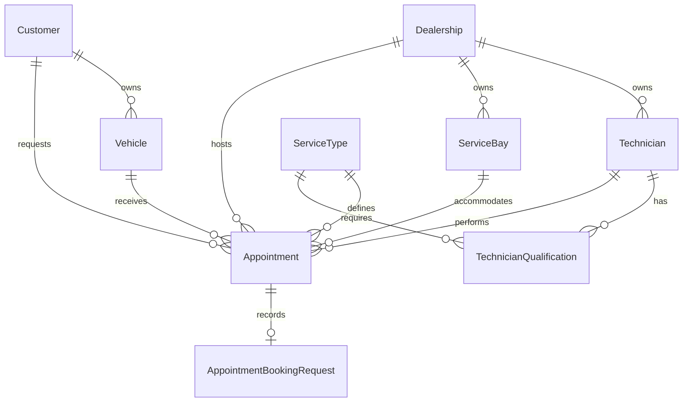

# Database and domain model

Current persistence reference for the scheduling backend. See the [system design](SYSTEM_DESIGN.md) for booking orchestration and [verification](FINAL_REVIEW.md) for recorded results.

## Model and relationships

- A dealership owns technicians and bays; each resource belongs to one dealership.
- A customer owns vehicles; VIN is globally unique.
- ServiceType has an integer duration greater than zero and an active flag.
- TechnicianQualification is an explicit many-to-many join with `(technician_id, service_type_id)` as its primary key.
- An appointment holds required references to customer, vehicle, dealership, service type, technician, and bay, plus start/end and status.

Domain entity IDs are native UUIDs, with PostgreSQL `gen_random_uuid()` defaults unless explicitly supplied. The qualification join uses two UUID foreign keys as its composite identity. The booking-request key is the client-supplied idempotency UUID. See the [Prisma schema](../prisma/schema.prisma) for fields and the [SQL migrations](../prisma/migrations) for database-only constraints. SQL names use snake_case; Prisma names use camelCase. All timestamps are `timestamptz(3)` to match JavaScript millisecond precision. Dealership time zone is a separate IANA-zone string for future local calendar rules; the database does not validate that string against an IANA registry.

Foreign keys use RESTRICT on deletion and ID updates. This protects referenced data/history rather than silently cascading deletions. Updating/removing reference data is not exposed in this implementation. Appointment B-tree indexes remain on customerId for history and technicianId/serviceBayId for all-status resource reference checks. Resource tables retain their dealership/active indexes. Further tuning should follow measured query plans.

The additive `20261105000000_trim_appointment_indexes` migration removes appointment indexes on vehicleId, serviceTypeId, and dealershipId/startAt because no current appointment lookup uses them. Foreign keys and both exclusion constraints remain intact. Parent deletion or ID-change checks for these unindexed references may scan appointments; no such public write API exists. This scope reduction makes no measured write-speed claim. Apply it with `npm run db:migrate`; existing rows are preserved and earlier migrations are unchanged.

## Integrity enforcement

| Rule                                                                                                 | Authority                                                             |
| ---------------------------------------------------------------------------------------------------- | --------------------------------------------------------------------- |
| Required columns, entity references, VIN uniqueness, unique qualification pair                       | SQL NOT NULL, foreign keys, unique index/composite primary key        |
| Positive service duration                                                                            | PostgreSQL INTEGER plus `service_types_positive_duration` CHECK       |
| `startAt < endAt`                                                                                    | `appointment_valid_interval` CHECK                                    |
| No overlapping confirmed appointments for a technician                                               | `no_overlapping_technician_appointments`                              |
| No overlapping confirmed appointments for a bay                                                      | `no_overlapping_bay_appointments`                                     |
| Qualification, active status, matching resource dealership and customer/vehicle ownership at booking | Booking application validation; ordinary FKs establish existence only |
| End time derived from the service duration, future start time, valid API input                       | Booking application validation                                        |

Both exclusion constraints are immediate/non-deferrable and use `tstzrange(start_at, end_at, '[)')`. They independently reject equal-resource overlapping intervals, including direct inserts and updates from different clients. Intervals ending exactly when another begins are accepted. `btree_gist` supplies UUID equality for these GiST constraints. See PostgreSQL's [range constraint documentation](https://www.postgresql.org/docs/17/rangetypes.html#RANGETYPES-CONSTRAINT) and [btree_gist documentation](https://www.postgresql.org/docs/17/btree-gist.html).

Only `CONFIRMED` blocks either resource. `CANCELLED` is represented to verify partial-constraint behavior; no cancellation feature is implemented. A cancelled row retains all associations and interval checks. Changing it back to confirmed must satisfy both exclusions. There is deliberately no vehicle-overlap exclusion, matching the agreed scope. All bays are interchangeable in the current design.

An appointment stores its scheduled start and end, so catalog duration changes do not rewrite history. There is no cross-table CHECK linking its length to today's service duration. There are no triggers for eligibility or active flags. Reference data must remain controlled; concurrent administrative changes require a later reviewed policy. `updatedAt` is maintained by Prisma writes; arbitrary SQL updates must set it explicitly if required. SQL fixtures use fixed intervals solely to test temporal relationships, independent of the current clock.

## Migrations and operational risks

`prisma/migrations/20261102000000_initial_domain/migration.sql` creates all eight tables, foreign keys/indexes, the status enum, CHECKs, and both exclusions in one explicit transaction. `migration_lock.toml` selects PostgreSQL. The base DDL was generated using Prisma migrate diff, then reviewed and extended with SQL-only constraints.

Run `npm run db:migrate` (`prisma migrate deploy`) against the intended database. No migration reset, drop, or development-data deletion is part of setup. On failure, inspect Prisma's migration status and the actual error; do not mark a failed migration applied without resolving its cause. Future schema changes require new reviewed migrations; do not edit an already deployed migration.

Risks and limitations:

- The migration role needs schema creation/DDL privileges and permission to install `btree_gist`. It is a trusted extension on standard PostgreSQL, requiring CREATE privilege on the database; managed hosts may impose additional restrictions. Verification used PostgreSQL 17.6 in Docker, not a hosted service.
- Adding exclusions to an existing populated table can fail on overlapping data and take locks during index construction. This initial migration targets a clean schema. Future data repair/migration plans must be reviewed separately.
- Prisma's schema does not express these CHECK/exclusion definitions. Committed SQL migrations are essential; `db push`, or rebuilding solely from the Prisma model, is insufficient. Tests apply actual migrations rather than mirroring the constraints in mocks.
- Exclusion conflicts can wait on another transaction. Observed raw-query errors are Prisma `P2010`; ORM inserts report `P2039`. Both expose PostgreSQL SQLSTATE in `meta.driverAdapterError.cause.originalCode` (`23P01` for exclusion). Integration coverage verifies both technician and bay ORM failures and maps the underlying SQLSTATE to a resource conflict. An unrelated `P2039` is not automatically retryable. This behavior is specific to the pinned Prisma/adapter versions.
- Concurrent database writes can also deadlock (`40P01`). Booking treats explicit deadlock/serialization failures (`40P01`, `40001`, or Prisma `P2034`) separately from exclusions, but retries both only after complete rollback in a fresh transaction. A real deadlock test verifies classification. The default budget is four total attempts. Exhaustion without a fresh determination of unavailability yields `503 BOOKING_CONTENTION`; empty candidate sets yield `409 NO_AVAILABILITY`.
- The resource exclusions guarantee non-overlap; they do not themselves provide request idempotency, fair resource allocation, or complete business validation. The approved booking-request table separately provides durable same-key coordination.

## Deterministic reference fixtures

`npm run db:seed` runs `prisma/seed.ts`, using the transactional `seedDatabase` function. IDs are exported in `prisma/seed-data.ts` and printed by the command. Timestamps are assigned on insertion; deterministic refers to fixture IDs and business values, not identical creation timestamps across databases.

| Fixture                           | ID pattern / values                                                           |
| --------------------------------- | ----------------------------------------------------------------------------- |
| Dealerships A/B                   | `10000000-0000-4000-8000-000000000001/2` (Asia/Ho_Chi_Minh / Europe/London)   |
| Customers 1–3                     | `20000000-0000-4000-8000-000000000001` through `...003`                       |
| Vehicles 1–4                      | `30000000-0000-4000-8000-000000000001` through `...004`; synthetic TEST VINs  |
| Oil / tires / inspection / brakes | `40000000-0000-4000-8000-000000000001` through `...004`; 30/60/90/120 minutes |
| Technicians A1/A2/A3/B1           | `50000000-0000-4000-8000-000000000001` through `...004`                       |
| Bays A1/A2/B1                     | `60000000-0000-4000-8000-000000000001` through `...003`                       |

Customer 1 owns vehicles 1/2, customer 2 owns vehicle 3, customer 3 owns vehicle 4. A1 supports oil/inspection, A2 tires/brakes, A3 oil/tires, B1 oil/inspection. There are 8 qualifications and no seeded appointments. Seed reruns insert missing rows only, preserving existing edits and appointments; conflicting pre-existing IDs/VINs can cause the seed transaction to fail rather than overwrite data.

## PostgreSQL integration verification

Start the separate `postgres-test` Compose profile service with `npm run db:test:up`. It uses port 55433 and tmpfs storage; development uses port 55432 and a named volume. Set `TEST_DATABASE_URL` from `.env.example`, then run `npm run test:integration`.

The harness requires the base database name `service_scheduler_test`; it never substitutes `DATABASE_URL`. Each run generates a new `scheduler_test_<uuid hex>` database, applies the committed migration through the real CLI, runs the real seed CLI, and drops that generated database afterward. The test role needs CREATEDB (the local Compose test role has it). No pre-existing database is reset. The two raw identifier statements use only this internally generated name; no caller-provided SQL is interpolated.

Tests inspect named constraints and actual SQLSTATEs, test all overlap shapes independently for technicians and bays, test adjacency in both directions, status predicates, SQL updates, required fields, all appointment FKs, reference FKs, unique keys, rollback, historical duration, and seed repeatability. The original database-level contention test runs 20 inserts through two clients. HTTP coverage additionally sends concurrent HTTP bookings through two Nest app instances, forces a real allocation conflict, verifies fresh-transaction recovery, and checks final row counts, qualifications, references, and SQL overlap invariants.

## Conflict-aware booking

The booking repository now uses single-item `createManyAndReturn` with `skipDuplicates` (PostgreSQL ON CONFLICT DO NOTHING), preserving both immediate exclusions. A skipped insert is classified separately from a detected primary-key collision and rolls back before retry. Plain ORM/raw-write regression probes still verify actual 23P01 violations. There are no explicit technician/bay row locks in the final booking path. Any new unique arbiter requires reviewing this classification.

PostgreSQL 17 fixed role/database defaults bound implicit index/FK waits and transaction work; tests verify inherited settings, cancellation, rollback, connection recovery, and shorter request budgets. Admission and retry delays do not hold database connections. See the [booking flow](SYSTEM_DESIGN.md#booking-flow) and [load evidence](LOAD_RESULTS.md).

## Fixed database timeouts

The approved policy is lock_timeout=250ms, statement_timeout=2s, transaction_timeout=5s. Apply it once with `npm run db:configure` after the local migration/seed setup. This executes [configure-database.sql](../scripts/configure-database.sql) in the Compose postgres service, using POSTGRES_USER and POSTGRES_DB. The script sets defaults only for the current role in the current database using safely quoted identifiers. It is repeatable, changes no schema/data, and affects new sessions; restart the app to replace existing pooled connections. PostgreSQL 17 is required. See [ALTER ROLE defaults](https://www.postgresql.org/docs/17/sql-alterrole.html).

In a production deployment, apply the same script while connected as the runtime role in its application database (or have an administrator configure that specific role/database pair). Keep maintenance/migration roles separately configured. The local challenge setup uses one role for both runtime and CLI tasks: later migration/seed connections with that identity inherit these limits too. Database configuration is an explicit setup step, separate from schema migrations; there is no configuration query inside each booking transaction.

The integration harness applies the same SQL after migration/seed in each owned temporary database, then reconnects so both fixtures and application pools inherit the defaults. PostgreSQL's five-second cap is fixed and terminates the database session when exceeded. Prisma's transaction timeout is based on the remaining request budget; a verified expired P2028 becomes BOOKING_TIMEOUT. The application checks its shared deadline before/after transaction work and between attempts. Cleanup/network/commit overhead means this is not a strict HTTP latency guarantee. A larger BOOKING_TIMEOUT_MS does not increase the database's fixed per-transaction limit.

## Durable booking request records

The additive `20261104000000_booking_idempotency` migration introduces the ninth model/table, `AppointmentBookingRequest` / `appointment_booking_requests`. Existing domain tables, data, seeds, exclusions, and fixed timeout defaults are unchanged. Apply with `npm run db:migrate`; no reset or backfill is required.

A UUID primary key coordinates same-key requests across instances. The table stores a SHA-256 fingerprint, nullable unique appointment FK, nullable JSONB public response, and creation time. CHECKs validate the fingerprint and pair the appointment/response fields, requiring an object snapshot when complete; the FK restricts deletion/update of linked appointment identities. In the supported application flow, both nullable fields are empty only during an uncommitted claim; the paired-field CHECK alone does not forbid a direct writer from committing two nulls. No normal transaction path commits an incomplete claim; unexpected incomplete or corrupt committed state returns a safe 500 rather than being reclaimed.

Key claiming precedes allocation in the same READ COMMITTED transaction. INSERT ON CONFLICT (key) DO NOTHING waits for an owner; a separate statement reads the committed winner. A claim-only 55P03 is retried after rollback with 25–50 ms jitter within the shared deadline, separately from four allocation attempts. The successful snapshot and appointment commit atomically; all failure paths roll back both. Successful keys are retained indefinitely. Tests delete request records before appointments only in their owned disposable fixtures. See [IDEMPOTENCY](IDEMPOTENCY.md).
