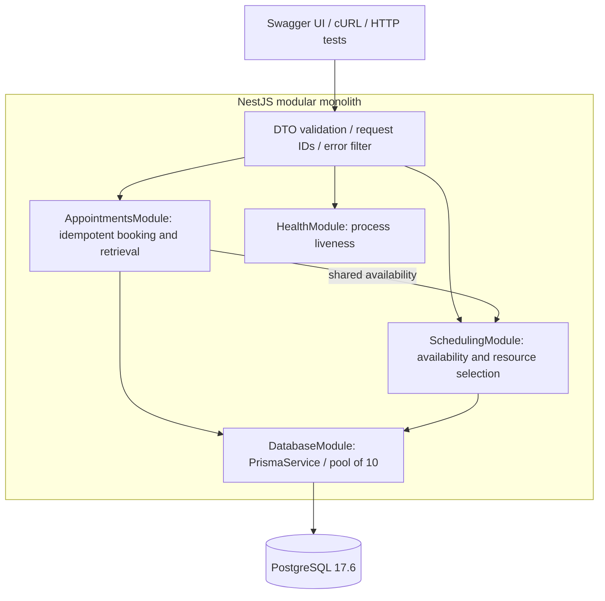
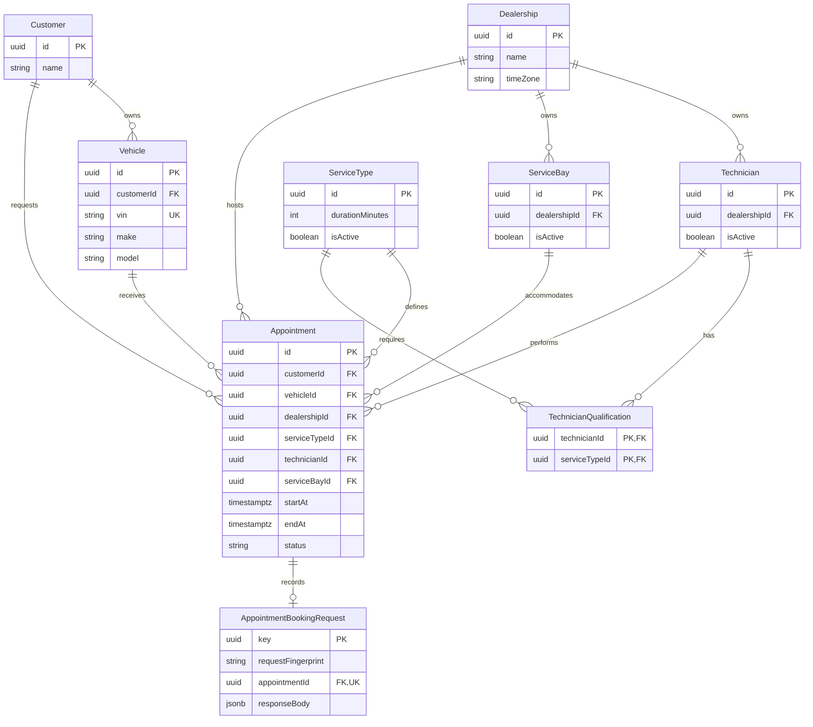
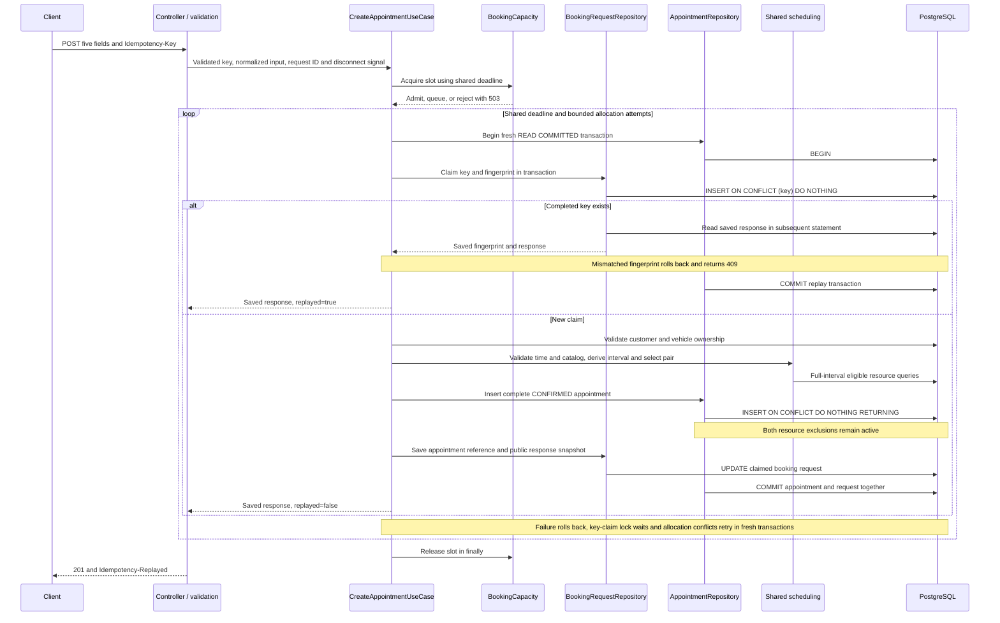

# System design — Keyloop Unified Service Scheduler

## 1. Problem overview

Replace manual dealership service booking with a backend that assigns a qualified technician and a service bay for the entire requested service interval, then persists a confirmed appointment. The original Keyloop Scenario A defines those three capabilities; the detailed policies below are documented implementation assumptions.

## 2. Functional requirements

The caller supplies customer, vehicle, dealership, service type, and desired start. The backend validates references/ownership, derives duration, selects eligible resources, and commits a complete appointment. Retrieval proves persistence; availability is read-only. [FINAL_REVIEW.md](FINAL_REVIEW.md) maps Keyloop requirements, SPEC P0 capabilities, acceptance criteria, and submission gates to executed evidence.

## 3. Non-functional requirements

Correct resource exclusivity across app instances, atomic writes, understandable code, reproducible setup, bounded failures, safe errors, and meaningful tests take priority. Keep the 100-request burst resilience criterion; 1,000 successfully committed bookings/second is an unverified future stretch goal, not a submission requirement or a verified Keyloop traffic need. Historical local diagnostics and future benchmarking guidance are recorded in [LOAD_RESULTS](LOAD_RESULTS.md) and [CAPACITY_PLAN](CAPACITY_PLAN.md), with no current-source or production capacity or latency SLO claim.

## 4. Assumptions and scope

- Backend-only modular monolith; Swagger and cURL supply the client demonstration.
- Service types are global; catalog durations are positive integral minutes. All active bays support all services.
- Resources belong to one dealership. Technicians must be active and service-qualified; bays must be active.
- Only CONFIRMED blocks resources. Intervals are half-open `[startAt, endAt)`; adjacency is permitted.
- Starts must be future instants with an explicit offset. Input uses seconds and at most three fractional digits; comparisons use absolute timestamps.
- Reference data is seeded, with no concurrent administrative API. Existing appointments retain their stored intervals after catalog changes.
- Durable idempotency is the approved P1 addition: POST requires a UUID v4 key; successful keys replay indefinitely.
- No cancellation/rescheduling API, vehicle-overlap exclusion, hours/shifts, authentication, frontend, or notifications.

## 5. Architecture



## 6. Component responsibilities

Controllers handle transport and call use cases. AppointmentsModule owns confirmation/retrieval orchestration and persistence. SchedulingModule owns the shared availability algorithm and deterministic selection. DatabaseModule owns connection lifecycle. Common HTTP infrastructure supplies validation, safe errors, and correlated logs. `/health` is process liveness; it does not query PostgreSQL on every request.

Repositories are concrete classes, with no generic repository framework. An optional Prisma transaction client passes through the shared scheduling use case into every query. This small coupling keeps booking and advisory availability on one algorithm. Pure interval functions remain independent of Nest/Prisma; the injectable clock makes time validation deterministic in tests.

## 7. Entity relationships



The diagram omits creation/update timestamps for readability. UUIDs, restrictive foreign keys, and `timestamptz(3)` are implemented in the actual migration. VIN is unique; the qualification pair is a composite primary key. See [DATABASE.md](DATABASE.md).

## 8. Booking sequence



Success exits the loop only after commit. A replay skips allocation and dynamic business validation. A failed claim/allocation leaves no committed processing record. Claim-only lock timeouts retry within the shared deadline without consuming allocation attempts. Allocation conflicts retain the four-attempt default; settled unavailability exits with 409, expired budgets with 503, and unexpected errors with 500. See [IDEMPOTENCY](IDEMPOTENCY.md).

## 9. Availability algorithm

Validate future time, dealership existence, and an active service type. Compute `endAt = startAt + durationMinutes * 60_000`. Two set-based queries select IDs from the requested dealership: technicians require qualification and active status; bays require active status. Both exclude CONFIRMED appointments satisfying:

```text
existing.startAt < requested.endAt AND existing.endAt > requested.startAt
```

The lowest technician and bay IDs form the pair. Counts and a boolean are returned publicly; internal candidate IDs are omitted from GET availability. Four SQL reads are used regardless of candidate count. Ordinary GET reads are independent and may become stale immediately. Booking invokes the same logic with its transaction client and never trusts a previous GET.

## 10. Concurrency and transactions

After claiming a new idempotency key, each allocation attempt uses one short Prisma interactive READ COMMITTED transaction: validate references and ownership, run shared scheduling, and attempt one complete row with single-item createManyAndReturn/skipDuplicates (PostgreSQL ON CONFLICT DO NOTHING RETURNING). Both exclusions remain active. A skipped insert is not success: an existing generated ID indicates an unexpected identity collision; otherwise the current schema's only other arbiters are the two resource exclusions, so it becomes a resource conflict. New appointment unique constraints require revisiting this classification. The separate booking-request table has its own explicit key-conflict handling; it adds no unique arbiter to the appointment INSERT.

There are no explicit resource-row locks. Earlier selected-resource locking addressed plain-insert deadlock storms but serialized unrelated intervals sharing a resource; the approved conflict-aware insert replaced it. A candidate can still become stale before insertion. The whole attempt rolls back before fresh allocation, and direct writes remain protected by PostgreSQL exclusions.

Default: four total allocation attempts, configurable from 1–10, with jittered backoff outside the transaction. Empty candidates return 409; unresolved conflict exhaustion returns 503. Connection failures are not automatically replayed by the server because a lost commit acknowledgement can have an unknown complete outcome; clients recover by retrying the same key. A per-process gate admits eight active bookings and 128 waiting by default; excess admission is BOOKING_BUSY. Queued disconnects/expiry free queue entries. An already running operation may commit despite client disconnect.

All attempts share one monotonic booking budget, default five seconds, including queueing/backoff. Transaction acquisition waits at most one second or the remaining budget. Prisma's transaction timeout uses the remaining budget at attempt start, with callback deadline checks before completion. Database setup separately configures fixed role/database defaults of 250 ms lock, 2 s statement, and 5 s transaction timeout; new connections inherit them. No per-booking configuration SQL is issued. Cleanup/commit/network overhead can exceed the nominal budget. See [DATABASE](DATABASE.md#fixed-database-timeouts); no external work occurs inside transactions.

Successful key claims, appointments, and serialized public responses commit atomically. Completed same-key/equivalent-body requests replay as 201 before time/catalog checks; different bodies return 409 IDEMPOTENCY_KEY_REUSED. Key-claim-only lock timeouts roll back before 25–50 ms backoff and fresh transactions within the shared deadline; they do not consume allocation attempts. Keys are retained indefinitely with no cleanup job. Incomplete/corrupt committed state is an internal error, not a reclaimable key. See [IDEMPOTENCY](IDEMPOTENCY.md).

## 11. Constraints and indexes

PostgreSQL enforces NOT NULL, reference FKs, unique VIN/qualification identity, positive service duration, and `startAt < endAt`. Separate immediate partial GiST exclusions enforce technician and bay non-overlap with `tstzrange(start_at, end_at, '[)')`, filtered to CONFIRMED. `btree_gist` supplies UUID equality. Committed SQL is essential; Prisma schema/db push cannot reconstruct these constraints.

Resource dealership/active indexes, qualification keys, appointment FK indexes, and a dealership/start index support access paths. Eligibility uses parameterized tstzrange overlap predicates matching the partial GiST expressions. Earlier diagnostic overlap-probe plans are recorded in LOAD_RESULTS; they do not establish every production query plan. Eligibility, ownership, active flags, and catalog-derived duration are application rules; ordinary FKs establish existence only.

The additive booking-request table has a UUID primary key, SHA-256 fingerprint, paired nullable appointment FK/JSONB response snapshot, creation time, unique appointment reference, and restrictive FK. The original eight domain tables and both exclusions are unchanged.

## 12. API contracts

| Route                                                | Success | Purpose                                                                                                                 |
| ---------------------------------------------------- | ------- | ----------------------------------------------------------------------------------------------------------------------- |
| `POST /api/v1/appointments`                          | 201     | Five input fields and required UUID v4 key header; assigned resource IDs, derived interval, CONFIRMED status, createdAt |
| `GET /api/v1/appointments/:id`                       | 200     | Persisted public appointment fields and relationship IDs                                                                |
| `GET /api/v1/dealerships/:dealershipId/availability` | 200     | Service/time query; interval, counts, boolean; no write                                                                 |
| `GET /health`                                        | 200     | `{ "status": "ok" }`                                                                                                    |
| `GET /docs`, `GET /docs-json`                        | 200     | Swagger UI and generated OpenAPI contract                                                                               |

Swagger uses explicit DTO/controller metadata through a shared setup function in production and HTTP tests. No compiler plugin or business API change was introduced. The [demo guide](DEMO_GUIDE.md) provides executable requests.

## 13. Technologies and trade-offs

NestJS provides modules, DI, validation, filters, and test support; TypeScript keeps contracts explicit. PostgreSQL provides transactional relational integrity and range exclusions across app instances. Prisma provides typed queries, with reviewed SQL for unsupported constraints. Vitest/SWC preserve Nest constructor metadata. Docker Compose supports reproducible local databases. Exact versions and the lockfile make upgrades deliberate; `npm ci` reproduces the resolved dependency graph.

An in-memory mutex or availability read alone cannot protect multiple instances. SERIALIZABLE isolation still requires conflict handling; global dealership/resource-row locks serialize unrelated intervals. Conflict-aware insertion with independent exclusions directly enforces resource exclusivity. The in-memory admission gate protects local capacity, while PostgreSQL protects correctness across instances. Stable ID ordering is easy to review but does not optimize fairness. No cache or additional service is justified without measurements.

## 14. Reliability and errors

Verified ORM exclusion errors carry Prisma `P2039` and underlying SQLSTATE `23P01`; raw SQL uses `P2010`. Classification reads adapter metadata, not message text or every generic `P2039`. Explicit `40P01`, `40001`, `55P03`, or Prisma `P2034` indicate transaction contention. Statement cancellation `57014` and transaction timeout `25P04` become temporary-service failures without replay. Raw-query connection refusal may use DatabaseNotReachable adapter metadata without a SQLSTATE. P2028 before callback entry is acquisition failure; after entry and overall deadline expiration it is BOOKING_TIMEOUT. Unrelated closed-transaction bugs stay unexpected.

Malformed input is 400; missing entities 404; settled unavailability or key reuse 409; invalid future time/ownership/inactive-service rules 422; admission/deadline/contention or recognized temporary database failure 503; unexpected failures 500. Availability uses the same safe temporary/unexpected database policy. Error bodies are `{ error: { code, message, details? }, requestId }`, with safe DTO details only. Retryable responses include Retry-After. Startup verifies `SELECT 1`; shutdown disconnects the pool.

## 15. Performance and scalability

Queries are set-based, with no per-candidate N+1 queries. Availability materializes candidate IDs and sorts them; large deployments should measure query plans and candidate-set size. Short transactions, bounded admission, deadlines, and ten-connection pools limit resource use. Keep the modular monolith and one PostgreSQL writer; app instances share its exclusions, and total pools must fit the database connection budget. A 100-request burst must yield 100 confirmations with sufficient eligible resource/time capacity, or one confirmation and 99 availability conflicts for a single contested pair/interval, with exact persisted counts, valid assignments, zero overlaps, and no overload or technical failures. The mandatory 20-request regression remains. Separate-process local diagnostics are historical; sustained 1,000 successful bookings/second remains an unverified stretch goal. CAPACITY_PLAN describes future benchmarking based on measured bottlenecks, without requiring database distribution or speculative hardware sizing. Fairness, representative-data tuning, and production telemetry remain future work.

## 16. Observability

Implemented: JSON console logs with request IDs; booking start, confirmation, admission rejection, unavailability, conflict/retry, duration, and unexpected failure events. Fields include dealership/service, appointment ID on success, outcome, elapsed/queue-wait milliseconds, retry count, admission counts on rejection, and available SQLSTATE. Names, VINs, request payloads, SQL, credentials, and raw database errors are omitted by these handlers. Request IDs appear in headers and error bodies.

Proposed production metrics: bookings by outcome, latency distribution, conflict/retry frequency, exhausted attempts, and pool saturation. Tracing could connect request/allocation/transaction spans when operational needs justify it. No metrics backend, trace exporter, collector, dashboard, or monitoring stack is implemented.

## 17. Security

This is an unauthenticated local assessment demo. Production needs identity, dealership authorization, rate limits, TLS/secret management, and a restricted migration/runtime role strategy. Strict DTO whitelisting rejects client assignments/duration/status and unknown properties. Prisma queries use bound values; the two test-only raw identifier statements interpolate only internally generated database names. Swagger is openly available for review. Dependency audits and repository checks are recorded with their scope in FINAL_REVIEW; they are not a complete security assessment.

## 18. Known limitations

Idempotency protects repeated requests using the same successful key, not response delivery or different keys. A transport failure during commit is resolved through a same-key retry. Different keys may create distinct bookings, including for the same vehicle. Advisory availability is not a transactionally consistent snapshot. Concurrent administrative changes are not supported. Concurrency suites use two app instances in one process; load diagnostics additionally use separate Node processes on one host. Multi-host/network faults, hosted extension permissions, populated-data migration locks, production load, and the future 1,000-successful-bookings/second stretch goal remain unverified.

## 19. Potential production improvements

Prioritize authenticated authorization, controlled reference-data updates, and operational metrics based on actual deployment needs. Working hours, cancellation, shifts, fairness, and specialized bays need separately agreed rules and tests. These are proposals; none is promised or implemented in this submission phase.

## 20. AI use during design

The developer selected Scenario A, backend scope, stack, Vitest, phased approvals, and simplicity constraints. AI assisted requirement interpretation, model/constraint alternatives, transaction/error strategy, implementation, tests, and documentation. The developer challenged guards, abstractions, relationships, and package choices; actual PostgreSQL and HTTP checks supplied evidence.

Real corrections include startup connectivity/metadata issues, Prisma error-shape assumptions, a race test that assumed only exclusion errors, temporary resource locking followed by approved conflict-aware insertion, and moving fixed timeouts out of each transaction. This merge resolved an older Phase 5 stash against commit 40352a1, preserving the current business implementation while restoring Swagger and submission documents. [README](../README.md#ai-collaboration-narrative) summarizes all stages; historical phase notes, LOAD_RESULTS, and [FINAL_REVIEW](FINAL_REVIEW.md) distinguish observed results from assumptions. The video remains a manual deliverable.

The subsequent approved idempotency addition uses a ninth model and an additive migration, preserving the booking/exclusion algorithm. The developer chose required booking keys, successful-response-only storage, indefinite retention, and bounded waiting for duplicates. The design explicitly handles replay after time/catalog changes and separates key waiting from allocation retries. Executed evidence is recorded in [IDEMPOTENCY](IDEMPOTENCY.md).
