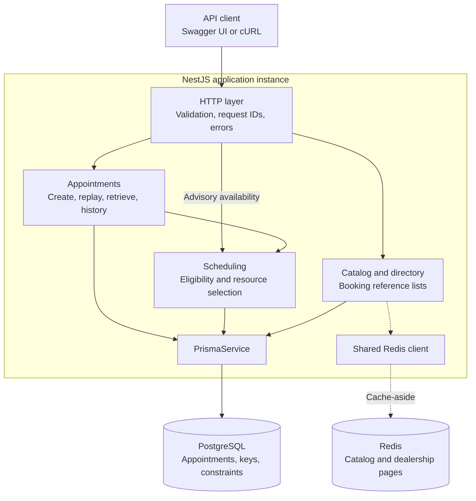
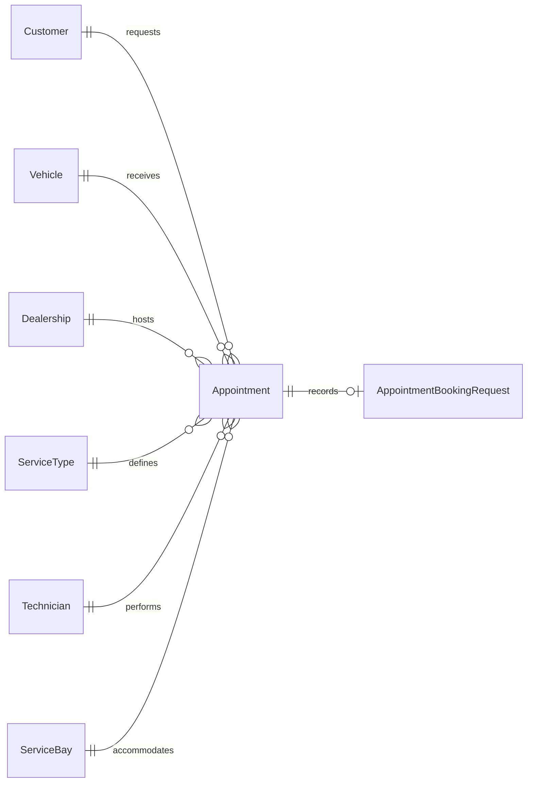
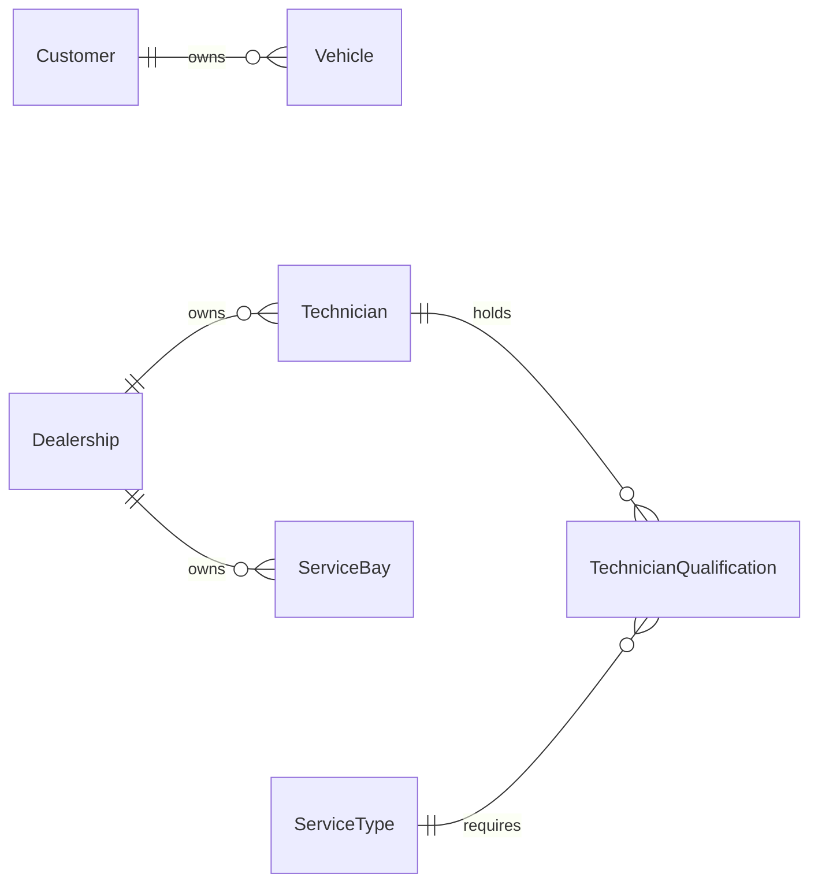
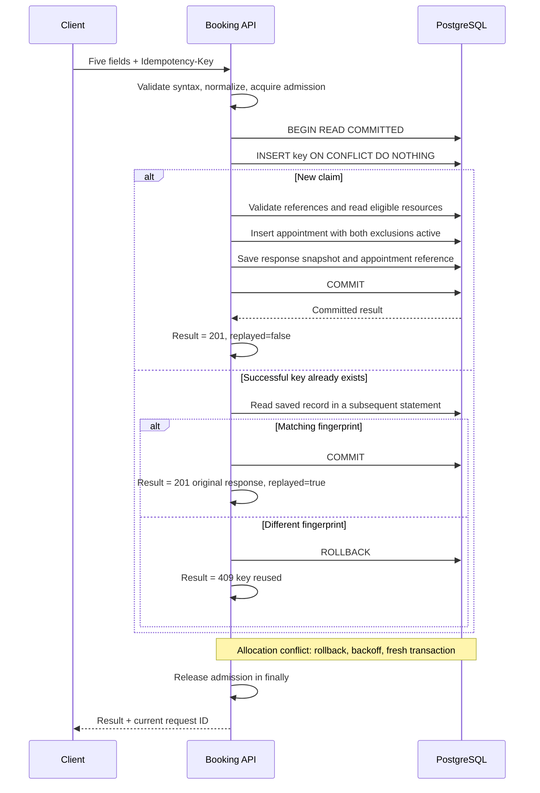
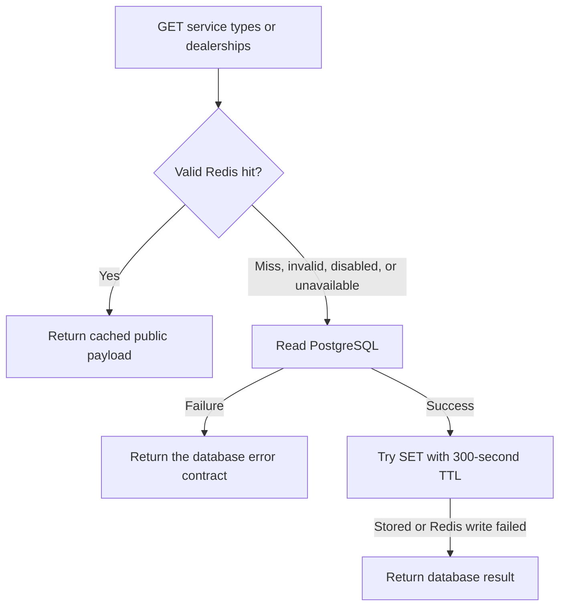

# System design — Keyloop Service Scheduler

A backend for booking vehicle services at a dealership. The server derives the service interval, assigns a qualified technician and an active bay, and commits a confirmed appointment without double-booking either resource.

The design uses a **NestJS modular monolith, one PostgreSQL writer, and shared Redis caching**. PostgreSQL owns booking correctness; Redis serves reference lists. This document describes the implemented assessment backend and the conditions for future changes.

[Run and test](../README.md#first-installation) · [API specification](SPEC.md#api-contract) · [Database reference](DATABASE.md) · [Verification evidence](FINAL_REVIEW.md)

**Read through:** [Architecture](#architecture) → [Data](#data-and-scheduling-rules) → [Booking](#booking-flow) → [Concurrency](#contention-and-failure-handling) → [Caching](#redis-caching) → [Operations](#api-and-observability) → [Verification](#verification-and-limitations) → [Scaling](#capacity-planning)

## Design goals and scope

The core workflow accepts a customer, owned vehicle, dealership, service type, and desired start time. A successful booking links those records to the automatically assigned resources. Availability supports time selection but does not reserve capacity.

| Quality goal                      | Design response                                                                                              |
| --------------------------------- | ------------------------------------------------------------------------------------------------------------ |
| Correctness                       | Authoritative eligibility checks and two database exclusion constraints protect the complete interval.       |
| Reliability                       | The key claim, appointment, and saved response commit together; failures roll back before bounded retries.   |
| Performance                       | Set-based resource reads, bounded pagination, reference caching, and admission limits control work.          |
| Scalability                       | App instances share PostgreSQL coordination and Redis reference data; capacity changes require measurements. |
| Maintainability and observability | Small modules, concrete use cases/repositories, real-database tests, and correlated structured logs.         |

Idempotency, lookup/history endpoints, and Redis are approved extensions. No Keyloop traffic volume is assumed. Authentication, working hours, cancellation/rescheduling, and notifications are outside the implementation scope. The [specification](SPEC.md#assessment-requirements-and-scope) distinguishes assessment requirements from additions.

### Scheduling assumptions

Where scheduling details are unspecified, this implementation assumes:

- **Services:** one global catalog, with a fixed positive whole-minute duration per service. Catalog edits do not recalculate existing bookings.
- **Bays:** every active bay supports every service; technicians require explicit service qualifications.
- **Time:** new bookings start in the future and require an explicit UTC offset. Opening hours and shifts are not modeled.
- **Overlap:** confirmed appointments block technicians and bays for `[startAt, endAt)`; adjacent bookings are allowed. Vehicle overlap is not prevented.
- **Reference changes:** catalog and resource data are maintained in controlled steps; concurrent administrative changes during booking are unsupported.

## Architecture



Solid arrows show the request/database path; dashed arrows mark the reference cache. Redis can be disabled, and cache failures fall back to PostgreSQL. Additional app instances use the same PostgreSQL database and the same Redis namespace for that database.

| Component            | Responsibility                                                                                                 |
| -------------------- | -------------------------------------------------------------------------------------------------------------- |
| Appointments         | Admission, booking transactions, durable replay, retrieval, and customer history.                              |
| Scheduling           | Service intervals, current eligibility, and deterministic allocation; shared with advisory availability.       |
| Catalog / Directory  | Service types, customers, owned vehicles, and dealerships. Only service types and dealership pages are cached. |
| Database / Cache     | One Prisma pool and at most one Redis connection per app instance; lifecycle and failure handling.             |
| Common HTTP / Health | DTO validation, safe errors, request IDs, structured logs, and process liveness.                               |

Controllers translate HTTP input/output; use cases coordinate work; repositories own persistence. Booking passes its Prisma transaction client through scheduling so validation and allocation use the booking transaction. This explicit coupling avoids a second availability algorithm or an unnecessary persistence abstraction.

### Technology choices and trade-offs

| Decision                                 | Reason and cost                                                                                                                                                           |
| ---------------------------------------- | ------------------------------------------------------------------------------------------------------------------------------------------------------------------------- |
| NestJS + TypeScript modular monolith     | Clear dependency injection and module boundaries with one deployment. Components share a runtime/database rather than scaling independently.                              |
| PostgreSQL + Prisma                      | Relational integrity, transactions, and range exclusions fit scheduling. Prisma provides typed queries; reviewed SQL migrations supply constraints Prisma cannot express. |
| Exclusions instead of resource-row locks | Every writer must satisfy non-overlap, including separate app instances. Conflicts still require rollback and fresh allocation.                                           |
| Idempotency in PostgreSQL                | Booking and replay state commit atomically and survive restarts. Retained response snapshots add storage and write cost.                                                  |
| Shared Redis for reference lists         | Instances reuse cached lists and degrade to PostgreSQL. Redis adds network/operational cost and eventual consistency.                                                     |

Docker Compose and the lockfile support reproducible local setup. Swagger executes the API. Vitest uses real PostgreSQL and Redis for persistence, concurrency, and cache behavior.

## Data and scheduling rules

**Booking and replay relationships**



**Ownership and qualification relationships**



Together, these views show all nine models and their relationships. `TechnicianQualification` is the many-to-many join: a technician can support several service types, and a service type can have several qualified technicians. Each resource belongs to one dealership; each vehicle belongs to one customer.

| Model                     | Key data and purpose                                                                                                            |
| ------------------------- | ------------------------------------------------------------------------------------------------------------------------------- |
| Customer                  | ID and name identify the booking customer.                                                                                      |
| Vehicle                   | Customer reference, unique VIN, make, and model identify an owned vehicle.                                                      |
| Dealership                | ID, name, and time zone define the resource location; the time zone is reserved for future local calendar rules.                |
| ServiceType               | Name, positive duration, and active flag define a bookable service and its interval length.                                     |
| Technician                | Dealership reference and active flag scope the technician; qualifications determine supported services.                         |
| ServiceBay                | Dealership reference and active flag scope an interchangeable bay.                                                              |
| TechnicianQualification   | Composite primary key `(technicianId, serviceTypeId)` prevents duplicate qualification pairs.                                   |
| Appointment               | Six required domain references, start/end, status, and timestamps record the scheduled booking.                                 |
| AppointmentBookingRequest | UUID key, request fingerprint, unique appointment reference, JSONB response snapshot, and creation time support durable replay. |

Domain IDs are UUIDs. Foreign keys restrict deletion/update of referenced identities rather than cascading away booking history. The [database reference](DATABASE.md#model-and-relationships) gives the physical model, complete fields, indexes, and migrations.

A new booking-request claim temporarily has no appointment reference inside its uncommitted transaction. Success completes that reference and its response snapshot together.

Booking validates vehicle/customer ownership, existing references, and an active service type. It selects active, service-qualified technicians and active bays from the requested dealership, choosing the lowest eligible technician ID and bay ID independently. Selection is deterministic, with no fairness claim.

The server derives `endAt` from the service duration; the client supplies neither duration nor end time. Instants are stored as `timestamptz(3)` and returned as UTC strings with millisecond precision.

### Preventing overlap

Only `CONFIRMED` appointments block resources. Intervals are half-open: `[startAt, endAt)`. For example, 10:00–10:30 and 10:30–11:00 can use the same resources.

`CANCELLED` exists in the stored status enum and constraint tests but has no public write API. Cancelled rows do not block resources; changing one to confirmed must satisfy both exclusions.

Two transactions can both read a resource as free. PostgreSQL arbitrates the writes through **independent technician and bay GiST exclusion constraints**, using `btree_gist` for UUID equality. The technician constraint is:

```sql
EXCLUDE USING gist (
  technician_id WITH =,
  tstzrange(start_at, end_at, '[)') WITH &&
) WHERE (status = 'CONFIRMED');
```

The bay constraint applies the same rule to `service_bay_id`. These protect direct SQL writes as well as application requests. Foreign keys, required fields, positive durations, and valid intervals are also database-enforced. Ownership, qualification, active status, and catalog-derived duration remain application rules.

Eligibility uses two set-based resource queries that exclude overlaps. Advisory availability additionally reads the dealership and service type: four SQL reads regardless of candidate count. Its result is an observation, not a reservation or a transactionally consistent snapshot.

The GiST indexes support interval conflict checks. Appointment B-tree indexes remain on `customerId` for history filtering and on `technicianId`/`serviceBayId` for resource-reference checks across all statuses. Resource tables index dealership/active status; qualification keys support service eligibility. Extra indexes add write/storage cost, so further indexes or history-sort optimization require measured query plans. Reviewed SQL migrations remain essential because Prisma's schema cannot express the exclusions and CHECK constraints.

## Booking flow



The diagram shows creation and replay paths. **Success is returned only after commit.** Any failure before commit rolls back the new claim, appointment, and snapshot together. A successful appointment insert followed by a failed snapshot write therefore leaves neither a booking nor a durable key.

### Idempotency contract

POST requires exactly one UUID v4 `Idempotency-Key`. Keys are global to this endpoint while authentication is absent. A versioned SHA-256 fingerprint includes all five normalized fields: four lowercase UUIDs and a UTC-millisecond start time.

| Request                            | Outcome                                                                             |
| ---------------------------------- | ----------------------------------------------------------------------------------- |
| New key, valid booking             | `201`, saved response, `Idempotency-Replayed: false`.                               |
| Successful key, equivalent payload | `201`, original ID, assignments, interval, and timestamps; replay header is `true`. |
| Successful key, changed payload    | `409 IDEMPOTENCY_KEY_REUSED`; no new appointment.                                   |
| Failed or rolled-back attempt      | No durable binding; the same key can be retried.                                    |

Replay precedes dynamic time/catalog/resource checks, so a committed booking remains replayable after its start passes or service duration changes. Header/body syntax is still validated. Saved public responses are shape-checked; unexpected incomplete or corrupt committed records return a safe 500 and are never silently reclaimed.

Concurrent same-key insertions coordinate through primary-key uniqueness. A conflicting insertion waits for the owner; after commit, a **subsequent READ COMMITTED statement** reads its saved result. If the owner rolls back, another request can claim the key. Successful records remain indefinitely during normal operation, with no TTL or cleanup worker.

After an uncertain response, clients reuse the same key and equivalent payload. A different key is an independent intent and may create another appointment on another pair. Resource exclusions do not deduplicate customer intentions. See the [full replay contract](IDEMPOTENCY.md).

## Contention and failure handling

| Control               | Default and purpose                                                                                        |
| --------------------- | ---------------------------------------------------------------------------------------------------------- |
| Active bookings       | 16 per app process.                                                                                        |
| Waiting bookings      | Up to 1,024 per process; excess requests receive `503 BOOKING_BUSY`. Waiting holds no database connection. |
| Allocation attempts   | Four total, each in a fresh transaction, with jittered backoff outside database work.                      |
| Shared booking budget | Five seconds across admission, attempts, and backoff; never renewed on retry.                              |
| Prisma pool           | Up to twenty connections per instance, shared with reads; no reserved read connections.                    |
| PostgreSQL limits     | 250 ms lock, 2 s statement, and 5 s transaction timeouts, configured for new connections.                  |

The repository uses single-item `createManyAndReturn` with `skipDuplicates`: `ON CONFLICT DO NOTHING RETURNING`. A returned row means insertion succeeded inside the transaction. A skipped insert becomes an allocation conflict unless its generated ID already exists, which is an unexpected identity collision. Additional uniqueness rules would require reviewing this classification.

Rollback completes before backoff. A retry has a new transaction identity and re-reads eligibility; the pool may reuse a physical connection. If T1/B1 were taken, an eligible T2/B2 can be selected. There are no explicit resource-row, advisory, or distributed locks.

| Condition                                 | Result                                                            |
| ----------------------------------------- | ----------------------------------------------------------------- |
| Fresh read finds no eligible pair         | `409 NO_AVAILABILITY`.                                            |
| Allocation conflicts exhaust the attempts | `503 BOOKING_CONTENTION`.                                         |
| Shared budget expires                     | `503 BOOKING_TIMEOUT`.                                            |
| Admission is full, closing, or cancelled  | `503 BOOKING_BUSY`.                                               |
| Recognized temporary database failure     | `503 SERVICE_UNAVAILABLE`; unexpected failures remain a safe 500. |

A lock timeout specifically during key claiming triggers rollback and a 25–50 ms wait before a fresh claim. These waits use the same deadline but do not consume allocation attempts. Other failures retain their existing classification.

Three seconds in admission leaves roughly two seconds of the booking budget. Prisma receives the remaining budget; PostgreSQL's limits are separate caps. Commit, cleanup, and network delivery can exceed the nominal budget, so it is not a strict HTTP deadline. A committed success is still returned as success if it arrives late.

Disconnecting while queued removes the waiter before any claim exists. Disconnecting during execution does not forcibly cancel the transaction: it may commit without delivering a response. Cancellation is checked before another attempt. Ambiguous connection failures are not automatically replayed inside the server; clients recover with the original key.

## Redis caching



Only **active service types and dealership pages** use shared cache-aside. Customers, vehicles, appointment history/retrieval, availability, booking, and idempotency remain uncached. Booking always reads authoritative PostgreSQL data.

| Read            | Key suffix after the deployment/database namespace |
| --------------- | -------------------------------------------------- |
| Active catalog  | `service-types:v1:active`                          |
| Dealership page | `dealerships:v1:page:<page>:limit:<limit>`         |

`CATALOG_CACHE_NAMESPACE` is explicit when Redis is enabled. Replicas for the same database share it; different databases/deployments use distinct namespaces. Public payloads are validated, including page/limit for dealership pages. Empty results are valid hits. Database reads sit outside Redis catches, preserving database error classification.

Population uses atomic `SET ... EX 300`; hits never renew expiry. Redis connects in the background, bypasses operations until ready, and disconnects on shutdown. One client per app uses a 1 s connection timeout, 100 ms command timeout, and 1 s pending-reply socket timeout. Offline queuing, command resending, and request-level retries are disabled; reconnect backoff is built in. Local Redis is disposable, without persistence, with a 64 MiB data budget.

### Maintenance and consistency

After a controlled database change commits:

- **Catalog:** read and replace the complete ordered active list; replacement resets its TTL.
- **Dealerships:** invalidate all pages/page sizes, then refill on demand. Prefix-filtered SCAN/UNLINK preserves unrelated keys; multiple batches are not atomic.

There is no reference-data update API. These are tested maintenance patterns: [catalog refresh](../test/integration/service-catalog.spec.ts) and [grouped invalidation](../test/integration/directory-cache.spec.ts). A failed refresh or overlapping stale refill can leave old data until expiry or another maintenance operation. Five minutes is entry lifetime after population, not a strict freshness bound from an update. PostgreSQL and Redis do not commit atomically; `set()` is best effort.

The four-row seeded catalog does not establish a database bottleneck. Tests prove shared query avoidance and fallback, not a latency gain. Concurrent misses may repeat the inexpensive query; coalescing, background refresh, and availability caching are not justified by current evidence.

## API and observability

### API surface

| Purpose               | Contract                                                                                                                                    |
| --------------------- | ------------------------------------------------------------------------------------------------------------------------------------------- |
| Obtain booking IDs    | List customers, owned vehicles, dealerships, and active service types. VIN distinguishes vehicles.                                          |
| Check availability    | GET dealership availability for a service/start; returns the interval, boolean, and eligible free-resource counts. No hold or resource IDs. |
| Create an appointment | POST five fields plus the key; `201` returns server-assigned resources and the committed public appointment.                                |
| Retrieve history      | GET an appointment by ID or a customer's appointments, including past/future and stored statuses.                                           |
| Inspect the service   | `/health` for liveness; `/docs` and `/docs-json` for Swagger/OpenAPI.                                                                       |

The client workflow is **customer → owned vehicle → dealership → service type → availability → booking → retrieval/history**. POST `/api/v1/appointments` accepts exactly `customerId`, `vehicleId`, `dealershipId`, `serviceTypeId`, and `startAt`, plus the idempotency header. Its public response contains the appointment ID, those domain references, assigned `technicianId`/`serviceBayId`, start/end, status, and creation time. Clients cannot choose resources or supply duration/end/status. Retrieval and history use the same public serializer.

Lookup/history lists use page/limit pagination, default 1/20 and maximum limit 100. Fetching one extra row derives `hasNext` without a total-count query. Service types remain a plain array. The [specification](SPEC.md#api-contract) defines exact routes, fields, validation, ordering, and errors; the [README](../README.md#try-a-booking) shows the request body.

Pages return `{ items, page, limit, hasNext }`. An existing customer with no vehicles/appointments gets an empty page; an unknown customer gets 404. Parent-scoped reads exclude other customers' records. Ordering includes an ID tie-breaker; history is newest start first. Offset pagination does not promise a fixed snapshot during concurrent inserts.

Malformed UUIDs/timestamps, unknown fields, invalid pagination, and missing/malformed/repeated idempotency headers return `400 VALIDATION_ERROR`. Missing domain records return 404. A nonfuture new booking, ownership mismatch, or inactive service returns 422. Errors share `{ error: { code, message }, requestId }`, with optional validation details; unexpected failures remain a safe `500 INTERNAL_ERROR`. Contention-related 409/503 outcomes are described above.

A valid availability query returns `200` even when `available: false`; a booking that cannot obtain a pair returns `409 NO_AVAILABILITY`.

### Lifecycle and failure visibility

| Situation                                | Observable behavior                                                                                                                        |
| ---------------------------------------- | ------------------------------------------------------------------------------------------------------------------------------------------ |
| PostgreSQL unavailable during startup    | Connectivity check fails; this instance does not begin serving requests.                                                                   |
| PostgreSQL fails after startup           | Recognized failures on database-dependent requests return 503; valid cache hits can still serve reference lists. `/health` may remain 200. |
| Redis unavailable while PostgreSQL works | Startup and booking proceed; reference reads fall back to PostgreSQL.                                                                      |

Startup checks configuration and PostgreSQL connectivity with `SELECT 1`, not schema/seed completeness. Apply migrations, seed data, and configure role/database defaults before starting. Shutdown hooks close Prisma and Redis. Local PostgreSQL persists in its Compose volume; Redis is disposable.

Each business HTTP attempt has a server-generated `x-request-id`. Structured logs correlate request duration, booking creation/conflicts/retries, replay/mismatch, cache outcomes, and classified failures. Public errors omit SQL, stacks, credentials, keys, and saved responses. Retryable 503 responses include `Retry-After: 1`.

Production metrics, alerts, and tracing are **proposed**, not installed: outcome counters, p95/p99 latency, queue depth, pool acquisition, transaction/lock waits, and cache hit/failure rates. `/health` is liveness, not continuous database readiness.

The guarded local [`demo:reset` utility](../prisma/reset-demo.ts) restores fixtures and removes appointments/keys in one database transaction, then invalidates reference caches. It is an explicit destructive local operation, not a public endpoint or production retention policy. Normal seeding preserves existing data.

## Verification and limitations

| Behavior                                    | Evidence                                                                                                                                                                                                |
| ------------------------------------------- | ------------------------------------------------------------------------------------------------------------------------------------------------------------------------------------------------------- |
| Intervals, eligibility, ownership, rollback | [Unit tests](../test/unit) plus real [database](../test/integration/database.spec.ts), [scheduling](../test/integration/scheduling.spec.ts), and [HTTP](../test/integration/booking-api.spec.ts) tests. |
| Actual race and fresh allocation            | [Concurrency tests](../test/integration/booking-concurrency.spec.ts) pause after real reads, inspect transaction/backend identities, observe conflicts, and check rows and overlap invariants.          |
| Replay, key waiting, lost responses         | [Idempotency tests](../test/integration/booking-idempotency.spec.ts) cover two instances, 100 same-key requests, restart recovery, and rollback at transaction stages.                                  |
| Cache and maintenance                       | PostgreSQL/Redis tests verify cross-instance hits, fixed expiry, malformed/empty values, fallback, refresh, and scoped invalidation.                                                                    |
| Reporting and local reset                   | [Report tests](../test/integration/load-report.spec.ts) retain evidence through a real SQL timeout; [reset tests](../test/integration/demo-reset.spec.ts) verify fixtures, rollback, and cache scope.   |

The mandatory 20-request contention regression yields one confirmation and nineteen availability conflicts. Separate distinct-key 100-request bursts confirm all requests with sufficient capacity, or one booking and 99 conflicts for one pair at one interval. These are resilience results, not sustained-throughput measurements. Dated commands, fingerprints, failed trials, and environment limits remain in [load results](LOAD_RESULTS.md) and [holiday experiments](HOLIDAY_PEAK.md).

This is an unauthenticated assessment backend. Relationship checks do not authorize the caller. Public deployment requires identity and customer/dealership access control, restricted runtime/migration roles, transport/secret management, tested backup restoration, readiness checks, and monitoring. Working hours, shifts, cancellation/rescheduling, specialized bays, vehicle-overlap prevention, and notifications need additional business rules. Concurrent administrative resource/catalog changes are unsupported.

The single PostgreSQL writer is a shared availability and capacity dependency. Automatic database failover and production recovery procedures are not implemented or verified.

## Capacity planning

**Concurrency counts requests in progress; throughput counts successful completions per second.** Queue size and replayed responses do not establish new-booking throughput. Resource exhaustion also differs from processing overload: another app instance cannot create technician/bay availability.

The optional `test:capacity` profile offers 1,000 new intents/second for five minutes across two app processes. It measures completions while arrivals continue, rejects net backlog growth, and reconciles acknowledgements with database state. Worker CPU/memory/event-loop samples and database activity/lock waits guide diagnosis. Individual query/transaction and pool-acquisition timings still need targeted measurement.

**Reliable sustained 1,000 successful bookings/second has not been achieved.** One minute-long trial passed, its identical repeat failed, and the five-minute attempt failed with overload/timeouts and incomplete database verification. The [full record](LOAD_RESULTS.md#full-five-minute-capacity-attempt--2026-11-06) preserves those limits. The runner now retains measurements when verification fails; that fix does not recover earlier missing metrics or establish more capacity. Latency is reported, but no p95/p99 acceptance threshold is agreed or enforced.

| Possible addition  | Evidence required and problem it could solve                                                                                                                                              |
| ------------------ | ----------------------------------------------------------------------------------------------------------------------------------------------------------------------------------------- |
| More app instances | Application saturation with PostgreSQL headroom. Each instance can open twenty connections and has its own admission limits; budget aggregate connections and measure again.              |
| Read replica       | Significant read pressure with acceptable replication lag. It can offload suitable reads, not booking writes; authoritative validation/allocation stays on the primary.                   |
| Message queue      | Work can finish later and consumers can drain the backlog. It can buffer asynchronous work; queueing booking itself needs an accepted/pending contract instead of immediate confirmation. |

Measure a controlled workload with representative data and agreed latency/error objectives. Inspect actual query plans or CPU profiles, change one factor, and repeat while retaining failures. A larger queue absorbs temporary bursts but cannot fix sustained excess arrivals. Read replicas and message brokers are not implemented here.

## AI use during design

The developer selected the backend scope, stack, phased approvals, and simplicity constraints. AI assisted requirements analysis, schema/constraint alternatives, implementation, tests, and documentation. The developer challenged generated assumptions and optional features, narrowed caching to reference lists, and removed technician listing because clients do not select resources.

The design evolved from resource-row locking to conflict-aware insertion with exclusions and bounded retries. PostgreSQL checks corrected Prisma error-shape assumptions and contention-test expectations. Later checks exposed a duplicate load-worker listener and lost measurement reports after verification failure; regressions cover those fixes. The developer retains responsibility for final decisions and submission. See the [README AI narrative](../README.md#ai-collaboration-narrative) and [development history](archive/VERIFICATION_HISTORY.md).
