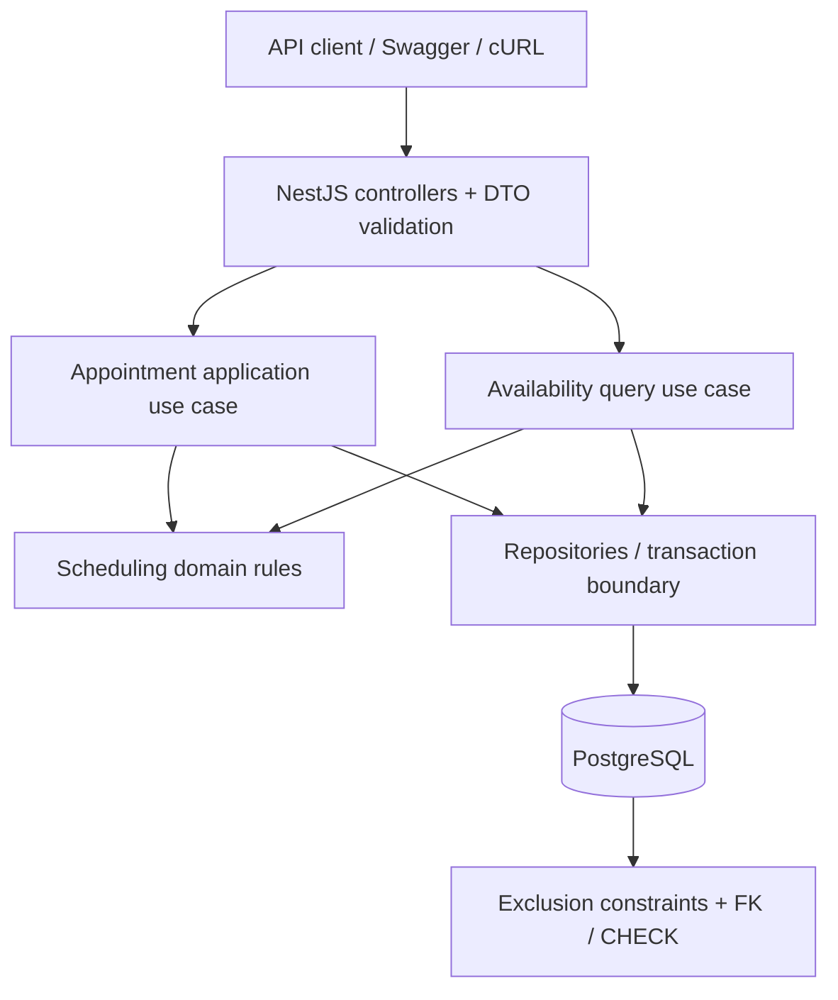

# Keyloop Technical Assessment — Scenario A: Unified Service Scheduler

> Historical planning or verification record; statements apply to their recorded source and date. Use the [current specification](../SPEC.md), [system design](../SYSTEM_DESIGN.md), and [verification summary](../FINAL_REVIEW.md) for current behavior.

> **Document:** Software Requirements & Implementation Specification  
> **Version:** 2.0 (revised from draft v0.1)  
> **Status:** Implementation-ready proposal; confirm P0 decisions before coding  
> **Target:** Backend service with a mocked/API-driven client  
> **Assessment deadline:** Friday, 6 November 2026 (target)  
> **Primary audience:** Implementing engineer, Codex, technical reviewer, and interviewer

---

## 1. Executive summary

Build a **reliable appointment-scheduling backend** for automotive dealerships. A client requests an appointment for a specific **customer, vehicle, service type, dealership, and start time**. The backend calculates the service duration, selects **one available service bay** and **one qualified available technician**, and creates a **persistent confirmed appointment**.

The central engineering challenge is **correct allocation under concurrent requests**. Two requests must never confirm overlapping use of the same technician or bay, even when they are processed by different application instances.

Implement a **modular NestJS application backed by PostgreSQL**, not a distributed system. Make database-enforced non-overlap, meaningful tests, a reproducible demo, and thoughtful design decisions the priorities. Build enough to resemble a credible real service, while explicitly documenting production capabilities not implemented.

### 1.1 What Keyloop explicitly requires

The original Scenario A names three core requirements:

| Source ID | Keyloop requirement                                                                                                      | How this project satisfies it                                      |
| --------- | ------------------------------------------------------------------------------------------------------------------------ | ------------------------------------------------------------------ |
| K-R1      | Request an appointment for a specified vehicle, service type, dealership, and desired time                               | `POST /api/v1/appointments`                                        |
| K-R2      | Check availability of both a ServiceBay and a qualified Technician for the **entire service duration** before confirming | Scheduling query + atomic booking + database integrity constraints |
| K-R3      | Persist a confirmed Appointment associating customer, vehicle, technician, and service bay                               | PostgreSQL Appointment record + retrieval API                      |

**Other assessment requirements:**

- Write a **System Design Document** with architecture diagram, component responsibilities, data flow, technology justifications, observability, and a design-phase AI-use section.
- Fully implement **either backend or frontend**. This project selects **backend**, requiring a RESTful API and **persistent database**; the frontend may be mocked using OpenAPI, cURL, or a test harness.
- Include a **README** with run/build/test instructions and a dedicated **AI Collaboration Narrative**.
- Provide automated tests of core business logic.
- Submit a **5–10 minute walkthrough video** covering design, code, demonstration, AI collaboration (1–2 minutes), and learning/challenges.
- Demonstrate problem solving, technical execution, AI direction/verification, and communication.

> **Source/assumption boundary:** The three K-R items above come from the assessment. All detailed domain policies, endpoints, technology choices, and P1 features below are **our design assumptions**, not additional promises from Keyloop.

### 1.2 Definition of success

A successful P0 submission must:

1. Create a valid appointment with a qualified technician and an available bay.
2. Reject impossible or invalid bookings without partial data.
3. **Guarantee non-overlap** for each technician and bay at the database level.
4. Preserve this guarantee when clients book concurrently.
5. Expose a reproducible HTTP/API demonstration and persist appointments across application restarts.
6. Include trustworthy test evidence, architecture documentation, and a concrete AI verification narrative.

**Not the goal:** maximize endpoint count, introduce fashionable infrastructure, or claim production readiness without implementing production controls.

---

## 2. Scope and priority contract

**P0 is the submission contract**; implement and verify it before working on P1. P1 is valuable but must not weaken P0 or delay the video and documentation. P2 is deliberately excluded from the implementation.

### 2.1 P0 — required for our implementation

| ID    | Capability                                     | Observable output                                                                                          |
| ----- | ---------------------------------------------- | ---------------------------------------------------------------------------------------------------------- |
| P0-01 | Seeded domain model and PostgreSQL persistence | Dealerships, customers, vehicles, service types, technicians, qualifications, bays, appointments           |
| P0-02 | Create appointment                             | `POST /appointments` confirms with assigned resources                                                      |
| P0-03 | Availability check                             | `GET /dealerships/:id/availability` uses live database state                                               |
| P0-04 | Appointment retrieval                          | `GET /appointments/:id` verifies persisted confirmation                                                    |
| P0-05 | Validation and business rules                  | Clear response for invalid time, entities, qualification, status, dealership, or customer/vehicle relation |
| P0-06 | Concurrency-safe allocation                    | PostgreSQL exclusion constraints + transaction + bounded conflict recovery                                 |
| P0-07 | Deterministic demonstration                    | Seed fixtures, example requests, OpenAPI or executable API examples                                        |
| P0-08 | Automated verification                         | Unit, real-PostgreSQL integration, HTTP, and concurrent tests                                              |
| P0-09 | Deliverable documentation                      | System design, README, AI narrative, video outline                                                         |
| P0-10 | Basic operational hygiene                      | Configuration validation, safe errors, request ID, structured booking logs                                 |

### 2.2 P1 — implement only after P0 is green

| ID    | Feature                          | Minimum credible implementation                                                                    |
| ----- | -------------------------------- | -------------------------------------------------------------------------------------------------- |
| P1-01 | Cancellation                     | Confirmed → cancelled, resources become available, defined error/idempotent behavior               |
| P1-02 | Idempotent booking               | Durable, transactionally consistent handling of `Idempotency-Key` and identical/changed payloads   |
| P1-03 | Dealership opening hours         | Simple recurring local schedule, correct time-zone conversion, no partial overlap outside schedule |
| P1-04 | Service type listing             | Read-only endpoint to simplify API exploration                                                     |
| P1-05 | Lightweight performance evidence | A reproducible benchmark and actual recorded numbers (never invented)                              |

**Approved P1 selection — 2026-11-04:** Durable booking idempotency and service-type listing with a narrowly scoped Redis catalog cache are the selected additions after P0. Cancellation and opening hours remain outside the approved scope. This is a project choice, not an extra Keyloop requirement.

### 2.3 P2 — document as future work, do not build

- Authentication, dealership authorization, roles, user onboarding.
- Technician shifts, holidays, time off, overtime, and workforce management.
- Specialized bay equipment, service-specific capacity, and technician–bay compatibility matrices.
- Multi-technician services, parallel stages, variable service duration and buffer times.
- Rescheduling, waitlists, notifications, approvals, payments, and audit history.
- Inventory dependencies, parts availability, service estimates, customer-facing frontend.
- Advanced matching/optimization, Kafka, Redis uses beyond the approved reference-list caches, microservices, event sourcing, orchestration, Kubernetes.

---

## 3. Domain terminology and assumptions

### 3.1 Business concepts

- **Dealership:** a single service location owning its technicians and bays.
- **Service type:** a defined operation with a fixed duration, e.g., oil change.
- **Qualified technician:** an active technician at the requested dealership with a qualification for the service type.
- **Service bay:** an active physical bay belonging to the requested dealership; all active bays are interchangeable in P0.
- **Appointment:** a resource reservation spanning a calculated interval with one technician and one bay.
- **Availability:** whether at least one compatible resource pair is free for the **entire requested interval**; it is not a mutable boolean on a resource.

### 3.2 Agreed P0 assumptions

| ID   | Decision                                                                                      | Rationale / limitation                                                         |
| ---- | --------------------------------------------------------------------------------------------- | ------------------------------------------------------------------------------ |
| A-01 | The caller provides `customerId`, `vehicleId`, `dealershipId`, `serviceTypeId`, and `startAt` | Backend-only demo; production authentication/authorization is out of scope     |
| A-02 | Backend, not client, assigns technician and bay                                               | Encapsulates scheduling decisions                                              |
| A-03 | Service duration comes from `ServiceType.durationMinutes`                                     | Prevents client-supplied underestimates                                        |
| A-04 | Service types are globally defined and bookable at any dealership with qualified resources    | No dealership-specific service catalog in P0                                   |
| A-05 | Each technician and bay belongs to exactly one dealership                                     | Prevents cross-location allocation                                             |
| A-06 | Technician qualifications are explicit many-to-many mappings                                  | No assumption that all technicians can perform all services                    |
| A-07 | Every active bay supports every service in P0                                                 | Specialized capabilities deferred                                              |
| A-08 | Appointment status is `CONFIRMED` on successful creation; `CANCELLED` is reserved for P1      | No provisional holds or payment workflows                                      |
| A-09 | Only `CONFIRMED` appointments block resources                                                 | Allows future cancellation behavior without redesigning constraints            |
| A-10 | Clients request a start time; the server calculates the exclusive end time                    | No client-supplied `endAt` or duration                                         |
| A-11 | Intervals use **half-open** boundaries `[startAt, endAt)`                                     | Adjacent appointments are allowed                                              |
| A-12 | All API input timestamps must contain `Z` or an explicit UTC offset; DB stores `timestamptz`  | Unambiguous instants; dealership time zone matters for P1 hours                |
| A-13 | P0 accepts future times only; operating hours are not enforced until P1                       | Explicit production limitation                                                 |
| A-14 | Candidate selection uses a stable order (e.g., IDs ascending)                                 | Simple, testable allocation; not optimized for fairness                        |
| A-15 | Appointments retain their stored start/end even if service catalog duration changes later     | Historical booking commitment is immutable in P0                               |
| A-16 | Reference data is seeded; there are no admin APIs                                             | Avoids concurrent resource/admin mutation workflows                            |
| A-17 | No vehicle-level scheduling exclusion in P0                                                   | May be a sensible future rule but not part of Keyloop's two required resources |

### 3.3 Validation semantics

- `startAt` is strictly later than the server's current instant. Use an injectable clock to make tests deterministic; do not rely on fixed calendar dates in tests.
- Reject malformed timestamps, missing offsets, invalid UUIDs, and unexpected/unknown DTO fields according to a clearly documented validation policy.
- `durationMinutes` must be positive and integral; persisted `endAt` must exceed `startAt`.
- Reject nonexistent dealership, customer, vehicle, or service type.
- Reject an inactive service type and a vehicle that does not belong to the provided customer.
- Exclude inactive technicians and bays; do not silently assign resources from another dealership.
- An `available: true` result is a **snapshot**, not a reservation or booking guarantee.
- Dates should be serialized consistently as ISO 8601 UTC strings in responses.

---

## 4. Domain model and database

### 4.1 Entities

| Entity                    | Core columns                                                                                                                                             | Notes                                              |
| ------------------------- | -------------------------------------------------------------------------------------------------------------------------------------------------------- | -------------------------------------------------- |
| `Dealership`              | `id`, `name`, `timeZone`, `createdAt`                                                                                                                    | Store an IANA zone for future opening-hours checks |
| `Customer`                | `id`, `name`, `createdAt`                                                                                                                                | Minimal seeded identity; avoid unnecessary PII     |
| `Vehicle`                 | `id`, `customerId`, `vin`, `make`, `model`, `createdAt`                                                                                                  | VIN unique; vehicle belongs to one customer        |
| `ServiceType`             | `id`, `name`, `durationMinutes`, `isActive`, `createdAt`                                                                                                 | Duration authoritative on booking                  |
| `Technician`              | `id`, `dealershipId`, `name`, `isActive`, `createdAt`                                                                                                    | One dealership per technician                      |
| `TechnicianQualification` | `technicianId`, `serviceTypeId`                                                                                                                          | Composite PK; references both entities             |
| `ServiceBay`              | `id`, `dealershipId`, `name`, `isActive`, `createdAt`                                                                                                    | One dealership per bay                             |
| `Appointment`             | `id`, `customerId`, `vehicleId`, `dealershipId`, `serviceTypeId`, `technicianId`, `serviceBayId`, `startAt`, `endAt`, `status`, `createdAt`, `updatedAt` | Assignment and reservation in one committed row    |

Use UUIDs for primary keys. Map these conceptual names to consistent snake_case SQL columns if preferred; do not mix naming conventions unpredictably.

### 4.2 Required relationships

- Customer `1:N` Vehicle; Customer `1:N` Appointment.
- Dealership `1:N` Technician; Dealership `1:N` ServiceBay; Dealership `1:N` Appointment.
- Technician `N:M` ServiceType via TechnicianQualification.
- Vehicle/ServiceType/Technician/ServiceBay each `1:N` Appointment.
- Every confirmed appointment has non-null customer, vehicle, dealership, service, technician, bay, and time fields.

### 4.3 Business invariants

| ID     | Invariant                                                                      | Enforcement                                |
| ------ | ------------------------------------------------------------------------------ | ------------------------------------------ |
| INV-01 | A confirmed appointment references both a technician and a bay                 | NOT NULL + foreign keys                    |
| INV-02 | `endAt > startAt`                                                              | DB CHECK and application validation        |
| INV-03 | Service duration is positive                                                   | DB CHECK (ServiceType)                     |
| INV-04 | A technician may not have overlapping confirmed appointments                   | PostgreSQL exclusion constraint            |
| INV-05 | A bay may not have overlapping confirmed appointments                          | PostgreSQL exclusion constraint            |
| INV-06 | Technician must be qualified for service **at booking time**                   | Application validation in booking workflow |
| INV-07 | Technician and bay must be active and belong to dealership **at booking time** | Application validation in booking workflow |
| INV-08 | Vehicle must belong to customer **at booking time**                            | Application validation in booking workflow |
| INV-09 | A failed confirmation persists no appointment                                  | Transaction/rollback                       |
| INV-10 | Original appointment interval remains stable after service catalog changes     | Persisted `startAt` and `endAt`            |

**Important limitation:** INV-06 through INV-08 are not automatically enforced by ordinary foreign keys. P0 treats seeded reference data as stable and has no admin-update endpoints. A production service that changes qualifications/ownership/status concurrently would need a stronger transactional policy, immutable reference snapshots, or schema-level enforcement where appropriate. Do **not** claim these cross-table invariants are universally database-enforced.

### 4.4 Database-enforced overlap prevention

Use PostgreSQL range overlap and partial GiST exclusion constraints on the **Appointment** table:

```sql
-- Illustrative SQL; adjust table/column names to actual migrations.
CREATE EXTENSION IF NOT EXISTS btree_gist;

ALTER TABLE appointments
  ADD CONSTRAINT appointment_valid_interval
  CHECK (end_at > start_at);

ALTER TABLE appointments
  ADD CONSTRAINT no_overlapping_technician_appointments
  EXCLUDE USING gist (
    technician_id WITH =,
    tstzrange(start_at, end_at, '[)') WITH &&
  ) WHERE (status = 'CONFIRMED');

ALTER TABLE appointments
  ADD CONSTRAINT no_overlapping_bay_appointments
  EXCLUDE USING gist (
    service_bay_id WITH =,
    tstzrange(start_at, end_at, '[)') WITH &&
  ) WHERE (status = 'CONFIRMED');
```

Required considerations:

1. Use the correct SQL names and enum representation produced by the chosen migration strategy. The SQL above is **illustrative**, not blindly copy/paste-ready.
2. Create the extension and constraints in versioned, reproducible SQL migrations. Prisma may require a custom SQL migration for these PostgreSQL-specific features.
3. Ensure attempts to insert conflicting appointments directly in PostgreSQL fail, bypassing application checks.
4. Ensure two adjacent intervals, where one ends exactly when the other starts, are allowed.
5. Handle the exclusion violation (`SQLSTATE 23P01`) as a booking-allocation conflict, **not** a generic 500 or an automatically successful retry.
6. Keep the two exclusion constraints; protecting just the bay or just the technician is insufficient.
7. If P1 cancellation is added, only `CONFIRMED` rows block availability; changing status to `CANCELLED` frees the interval after commit.
8. Avoid designing a separate mutable `isAvailable` field for bays or technicians. `isActive` means operational status only.

### 4.5 Availability overlap rule

Two half-open intervals conflict if and only if:

```text
existing.startAt < requested.endAt
AND
existing.endAt > requested.startAt
```

For an existing booking at **10:00–11:00**:

| Requested interval | Overlap? |
| ------------------ | -------- |
| 09:00–10:00        | No       |
| 11:00–12:00        | No       |
| 10:30–11:30        | Yes      |
| 09:30–10:30        | Yes      |
| 10:15–10:45        | Yes      |
| 09:00–12:00        | Yes      |
| 10:00–11:00        | Yes      |

### 4.6 Index and query expectations

- Filter resource candidates by dealership, active status, and qualification **in the database**.
- Exclude resources having overlapping `CONFIRMED` appointments for the interval.
- Avoid one database query per technician/bay (N+1).
- Index foreign keys and high-selectivity lookup predicates where justified by queries.
- The exclusion indexes support overlap enforcement; inspect query plans before adding redundant indexes.
- Do not introduce Redis as the authoritative availability cache.

---

## 5. Architecture and responsibilities

### 5.1 Stack

| Concern         | Choice                                | Reason                                                      |
| --------------- | ------------------------------------- | ----------------------------------------------------------- |
| Language        | TypeScript                            | Strong contracts, testability, current team familiarity     |
| HTTP / DI       | NestJS                                | Clear boundaries, input validation, testable orchestration  |
| Database        | PostgreSQL                            | Durable records, transactions, range/exclusion constraints  |
| Data access     | Prisma                                | Typed queries and migrations; use custom SQL where required |
| Tests           | Vitest (selected by the user)         | Fast unit tests; use real PostgreSQL for integration        |
| API exploration | Swagger / OpenAPI, plus cURL examples | Backend demonstration without a full frontend               |
| Environment     | Docker Compose (PostgreSQL)           | Reproducible setup                                          |
| Logging         | Built-in structured logger or Pino    | Request correlation and safe operational diagnosis          |

Pin versions in the repository lockfile; document the actual runtime and migration commands after verification. Avoid unverified claims about version-specific ORM capabilities.

### 5.2 Modular monolith (logical view)



Keep dependencies directed toward business logic. Avoid forcing a complex Clean Architecture framework if it creates more boilerplate than benefit.

### 5.3 Responsibilities

- **Controller:** routing, DTO validation, status codes, request context, and OpenAPI.
- **CreateAppointment use case:** load business context, compute interval, find candidates, coordinate atomic persistence, interpret conflicts, retry safely.
- **CheckAvailability use case:** read-only snapshot of qualified resources and bays, using the same domain predicates/query semantics as booking.
- **Scheduling rules:** pure interval and eligibility decisions; no HTTP or ORM dependencies.
- **Repositories / transaction adapter:** efficient candidate queries, appointment reads/writes, transaction management, SQL error classification.
- **Database:** final durable authority for resource exclusivity and referential integrity.

### 5.4 Suggested layout (adapt, do not overabstract)

```text
src/
  main.ts
  app.module.ts
  common/
    errors/
    logging/
    time/
  appointments/
    appointments.module.ts
    appointments.controller.ts
    dto/
    create-appointment.use-case.ts
    appointment.repository.ts
  scheduling/
    scheduling.module.ts
    check-availability.use-case.ts
    allocation.service.ts
    scheduling.repository.ts
    interval.ts
  catalog/
    catalog.module.ts
    catalog.repository.ts
  database/
    prisma.service.ts
prisma/
  schema.prisma
  migrations/
  seed.ts
test/
  unit/
  integration/
  e2e/
  helpers/
docs/
  SPEC.md
  SYSTEM_DESIGN.md
  DECISIONS.md
README.md
AGENTS.md
```

No generic base repository, abstract factory hierarchy, or separate module per trivial entity merely for symmetry. The repository may be simpler than this tree if responsibilities remain clear.

---

## 6. P0 API contract

Base prefix: `/api/v1`. Use `application/json`. UUIDs, actual field names, and timestamps should be consistent in API, docs, and tests. Seed IDs should be discoverable from README or seed output.

### 6.1 `POST /api/v1/appointments` — confirm booking

**Request:**

```json
{
  "customerId": "<uuid>",
  "vehicleId": "<uuid>",
  "dealershipId": "<uuid>",
  "serviceTypeId": "<uuid>",
  "startAt": "2026-11-05T03:00:00Z"
}
```

**Successful response — `201 Created`:**

```json
{
  "id": "<uuid>",
  "customerId": "<uuid>",
  "vehicleId": "<uuid>",
  "dealershipId": "<uuid>",
  "serviceTypeId": "<uuid>",
  "technicianId": "<uuid>",
  "serviceBayId": "<uuid>",
  "startAt": "2026-11-05T03:00:00.000Z",
  "endAt": "2026-11-05T03:30:00.000Z",
  "status": "CONFIRMED",
  "createdAt": "<iso-8601-utc>"
}
```

`endAt` example assumes a **30-minute** service type. The client does not supply the duration, technician, or bay. Use a consistent serialization precision; the exact fractional-second display is not part of the business contract.

**No pair available — `409 Conflict`:**

```json
{
  "error": {
    "code": "NO_AVAILABILITY",
    "message": "No qualified technician and service bay are available for the requested interval."
  }
}
```

**Important:** A conflict response must not leave a confirmed appointment behind. Do not expose raw SQL or stack traces.

### 6.2 `GET /api/v1/dealerships/:dealershipId/availability`

Query params: `serviceTypeId` and `startAt` (URL-encoded explicit-offset timestamp).

Example:

```http
GET /api/v1/dealerships/<uuid>/availability?serviceTypeId=<uuid>&startAt=2026-11-05T03%3A00%3A00Z
```

**Response — `200 OK`:**

```json
{
  "dealershipId": "<uuid>",
  "serviceTypeId": "<uuid>",
  "startAt": "2026-11-05T03:00:00.000Z",
  "endAt": "2026-11-05T03:30:00.000Z",
  "available": true,
  "availableTechnicianCount": 2,
  "availableServiceBayCount": 1
}
```

Semantics:

- Count only active, qualified technicians at that dealership who are free for **the full interval**.
- Count active bays at that dealership free for the full interval.
- Under P0's interchangeable-bay assumption, `available = technicianCount > 0 && bayCount > 0`.
- No appointment or reservation is created by this endpoint.
- Results can become stale immediately. `POST /appointments` revalidates and commits independently.

### 6.3 `GET /api/v1/appointments/:appointmentId`

- `200 OK`: the persisted appointment and resource IDs (optionally include small nested display summaries consistently).
- `400 Bad Request`: malformed UUID.
- `404 Not Found`: unknown appointment.
- Persistence must survive application restarts.

### 6.4 Error contract

Use one stable format:

```json
{
  "error": {
    "code": "MACHINE_READABLE_CODE",
    "message": "User-safe explanation",
    "details": {}
  },
  "requestId": "<request-id>"
}
```

`details` and `requestId` may be omitted if not available, but document a consistent policy. Suggested mappings:

| Failure                                                            | HTTP | Code                      |
| ------------------------------------------------------------------ | ---: | ------------------------- |
| Malformed DTO, timestamp, identifier, missing offset               |  400 | `VALIDATION_ERROR`        |
| Existing fields but start time is not in the future                |  422 | `INVALID_BOOKING_TIME`    |
| Customer, vehicle, dealership, service type or appointment missing |  404 | `<ENTITY>_NOT_FOUND`      |
| Vehicle does not belong to customer; service type inactive         |  422 | `BUSINESS_RULE_VIOLATION` |
| No eligible technician/bay for interval                            |  409 | `NO_AVAILABILITY`         |
| Repeated contention exhausted while availability is indeterminate  |  503 | `BOOKING_CONTENTION`      |
| Admission capacity exhausted                                       |  503 | `BOOKING_BUSY`            |
| Overall booking budget expired                                     |  503 | `BOOKING_TIMEOUT`         |
| Recognized temporary database/pool failure                         |  503 | `SERVICE_UNAVAILABLE`     |
| Unexpected DB / server error                                       |  500 | `INTERNAL_ERROR`          |

Do not label a genuine transient database failure as ordinary unavailability. Do not retry bad inputs or permanent rule violations.

---

## 7. Booking workflow and transaction correctness

### 7.1 P0 algorithm

1. Validate syntax, UUIDs, and offset-aware timestamp.
2. Load customer, vehicle, dealership, and service type. Validate relationships and service active status.
3. Compute `[startAt, endAt)` using `durationMinutes` from the service catalog.
4. For each attempt, get **fresh** eligible, non-conflicting technician/bay candidates in a stable order.
5. If either candidate set is empty, stop with `409 NO_AVAILABILITY`.
6. Select a candidate pair and **atomically** attempt a `CONFIRMED` appointment insert using `ON CONFLICT DO NOTHING RETURNING` with both exclusion constraints unchanged. A skipped insert is not success; detect an unexpected identity collision separately from an allocation conflict.
7. Commit before returning `201`.
8. If the insert is skipped for a resource conflict or a verified exclusion/aborted-transaction conflict occurs because another booking won the race, roll back, start a **new transaction**, re-read candidates, and retry within a small documented limit.
9. If attempts are exhausted solely because of continuing contention and the system cannot determine unavailability, return a clearly retryable `503 BOOKING_CONTENTION` (not a false `409`).
10. Unexpected database failures follow the error policy and must never produce a success response.

Do not put expensive work or external calls inside the transaction. Prefer short transactions. Reuse transaction context correctly in repository calls; avoid querying through a global database client when consistency requires the transaction client.

### 7.2 Transaction/isolation policy

- **READ COMMITTED** is an acceptable starting point because database exclusion constraints enforce the primary non-overlap invariants.
- A normal transaction plus read-before-write checks **without** an exclusion constraint is insufficient.
- Exclusion constraints detect conflicts between concurrent writes; an insert may wait for a concurrent transaction before succeeding or failing.
- Catch and classify the specific database error (SQLSTATE or verified ORM-mapped error), not arbitrary exceptions.
- On a failed write, roll back the transaction completely and begin a new attempt; never continue querying in a PostgreSQL transaction already marked aborted.
- A bounded retry policy (e.g., **maximum four total allocation attempts**) is a starting point. It is not a throughput or fairness guarantee. Implement the limit in one place, test the exhausted path, and document it.
- The approved concurrency hardening uses conflict-aware insertion rather than explicit technician/bay row locks. Keep both immediate GiST exclusions and verify direct-write rejection independently. The current appointment arbiters are its primary key and the two exclusions; any new unique constraint requires review of skipped-insert classification.
- Admission is bounded per instance: default **8 active bookings** and **128 pending**, with a ten-connection runtime pool. Queue wait holds no database connection; queued requests are removed on client disconnect. Excess admission returns `503 BOOKING_BUSY`.
- One monotonic booking budget defaults to **5,000 ms**, including admission, attempts and backoff. Expiration before confirmation returns `503 BOOKING_TIMEOUT`. PostgreSQL 17 uses fixed role/database defaults: **250 ms lock timeout, 2 s statement timeout, 5 s transaction timeout**. Apply scripts/configure-database.sql once during setup; defaults take effect on new connections. There is no per-booking configuration query. Prisma's transaction timeout uses the remaining budget at the start of an attempt, with an acquisition cap of one second. Check the deadline again inside the callback before commit. Fixed database safety limits and the overall booking deadline are separate; cancellation/rollback/commit/network overhead can exceed the nominal request budget. Never return a failure merely because the budget expired after a successful commit.
- Retry backoff uses jittered 10–30 ms steps with exponential growth, outside a fully rolled-back transaction. No connection is held during backoff. Connection/commit-acknowledgement failures are not automatically replayed.
- Lock timeout 55P03 is a transaction-contention outcome. Statement cancellation 57014 and transaction timeout 25P04 yield a temporary-service 503 without automatic replay. P2028 is treated as acquisition failure if the callback never started, or BOOKING_TIMEOUT if the callback started and the overall deadline has expired. Unrelated closed-transaction bugs before expiration remain unexpected.
- Idempotency of repeated **client requests** is separate from contention retries and is P1.

### 7.3 Why this is not a full production scheduler

- A valid available pair in one snapshot might be lost before the transaction commits.
- Deterministic candidate ordering can cause contention on the same resources. Randomized/fair selection and sophisticated queuing are not required in P0.
- If all retries are consumed under extreme contention, a request can fail transiently even while other combinations later become available; this is an explicit limitation.
- Active/qualification changes are not exposed as concurrent admin operations in P0.
- No durable temporary holds or booking expiration workflow is provided.

---

## 8. P0 functional acceptance criteria

Acceptance criteria use **Given / When / Then** where helpful. Every P0 criterion must have at least one automated test or clearly identified verification evidence.

### AC-F01 — Valid booking

- **Given** a customer-owned vehicle, active service type, one qualified active technician and one active bay at the requested dealership, all free for the duration; **when** a booking request arrives; **then** return `201` with one persisted `CONFIRMED` appointment and assigned resources.
- The server derives end time from the service catalog; no client-provided `endAt`, duration, or resource IDs are accepted.

### AC-F02 — Valid references and ownership

- Missing or malformed fields return a consistent `400` without creating an appointment.
- Missing referenced entities return `404` without creating an appointment.
- A vehicle belonging to another customer returns `422` without creating an appointment.
- An inactive service type returns `422` without creating an appointment.

### AC-F03 — Time correctness

- A timestamp without an explicit offset is rejected.
- Past or current start time is rejected (business rule `422`).
- Calculated end is strictly after start; duration is positive.
- The same instant supplied with different valid offsets produces the same UTC reservation interval.
- Intervals are half-open, so adjacent bookings are permitted.

### AC-F04 — Resource eligibility

- Only technicians qualified for the requested service are considered.
- Inactive and other-dealership technicians and bays are never assigned.
- If there is no qualified free technician or no free bay, the booking returns `409` and persists nothing.
- If the first technician or bay is occupied, an alternative available one may be selected.

### AC-F05 — Entire-duration availability

- Detect every type of partial or complete time overlap for **each** resource.
- Two bookings may share a resource only when their intervals do not overlap.
- A cancelled appointment does not block resources if cancellation is implemented in P1.

### AC-F06 — Availability endpoint

- For a valid query, return correctly calculated start/end, counts, and `available`.
- Calling the endpoint must not mutate appointment data.
- Availability snapshots do **not** reserve resources; subsequent POST can fail after another booking succeeds.

### AC-F07 — Atomicity and persistence

- Successful booking is committed before `201` is returned.
- DB failure or conflict must not leave a partial or phantom confirmed appointment.
- GET returns the committed appointment; app restart does not erase it.

### AC-F08 — Concurrent correctness

- No two confirmed rows may overlap on the same technician or the same service bay, even when inserts are concurrent.
- With **one qualified technician + one bay** and **20 distinct concurrent requests** for the same interval, **exactly one** appointment is committed; the other requests fail without a confirmed appointment. Expected HTTP failures are `409` after competitors settle; `503` is acceptable only for documented persistent contention with bounded retry exhaustion, not an ordinary resource shortage.
- With **two qualified technicians + two bays** and **two concurrent requests**, both should complete successfully under isolated test conditions with sufficient retry budget and no unrelated contention; they must be assigned non-conflicting resources.
- Database constraints must reject direct conflicting writes that bypass the application layer.

### AC-F09 — Error handling and observability

- Expected validation and unavailability conditions do not leak raw stack traces or SQL.
- Important booking outcomes and contention retries are logged with request correlation and no unnecessary customer PII.
- An unexpected infrastructure error is distinguishable from a business conflict.

### AC-F10 — Reproducibility and documentation

- An engineer can clone, install, start PostgreSQL, migrate, seed, start the API, and run tests by following README without tribal knowledge.
- Documentation includes diagrams, trade-offs, constraints, known limitations, and AI collaboration evidence.

---

## 9. Test matrix and verification plan

**Testing principle:** tests should prove invariants, not merely assert mocked method calls. Unit tests can mock repositories; transaction/exclusion tests **must use real PostgreSQL**. Do not use SQLite for PostgreSQL-specific constraint tests.

### 9.1 Core automated cases (P0; approximately 24 scenario groups)

| Test ID | Level            | Setup / action                                                                   | Required assertion                                                            |
| ------- | ---------------- | -------------------------------------------------------------------------------- | ----------------------------------------------------------------------------- |
| T-01    | API              | Valid appointment request                                                        | `201`, assigned qualified technician and bay, correct duration, persisted row |
| T-02    | API              | Missing field, invalid UUID, malformed timestamp, no offset                      | `400`; no write                                                               |
| T-03    | API              | Start time not strictly future                                                   | `422`; no write                                                               |
| T-04    | API              | Missing customer, vehicle, dealership, or service                                | `404`; no write                                                               |
| T-05    | API              | Vehicle belongs to a different customer                                          | `422`; no write                                                               |
| T-06    | API              | Service type inactive                                                            | `422`; no write                                                               |
| T-07    | Unit/integration | Technician lacks qualification                                                   | Excluded; if no alternative, `409`                                            |
| T-08    | Integration      | Technician inactive / other dealership                                           | Never assigned                                                                |
| T-09    | Integration      | Bay inactive / other dealership                                                  | Never assigned                                                                |
| T-10    | Unit             | All overlap shapes: identical, contained, containing, start overlap, end overlap | Overlap predicate true                                                        |
| T-11    | Unit/integration | Adjacent intervals (`end == next.start`)                                         | Non-overlap; allowed                                                          |
| T-12    | Integration      | Only technician occupied; another technician is free                             | Choose available technician                                                   |
| T-13    | Integration      | Only bay occupied; another bay is free                                           | Choose available bay                                                          |
| T-14    | API              | No eligible technician                                                           | `409`, zero new appointments                                                  |
| T-15    | API              | No eligible bay                                                                  | `409`, zero new appointments                                                  |
| T-16    | API              | Check availability when free / busy                                              | Correct counts/boolean and no side effects                                    |
| T-17    | API/integration  | Availability initially true, competitor books before POST                        | POST rechecks; conflict or alternative pair; no double-booking                |
| T-18    | Integration      | Direct PostgreSQL insert with overlapping technician                             | Exclusion constraint rejects it                                               |
| T-19    | Integration      | Direct PostgreSQL insert with overlapping bay                                    | Exclusion constraint rejects it                                               |
| T-20    | Integration      | Forced error during transactional booking                                        | Rollback; no partial/false success                                            |
| T-21    | Integration      | Create then retrieve, restart using persistent DB                                | Identical committed data still exists                                         |
| T-22    | Concurrency      | 20 distinct requests, one technician and one bay, same interval                  | Exactly 1 confirmed row; others unsuccessful; DB invariant holds              |
| T-23    | Concurrency      | Two requests, two qualified technicians and two bays                             | Both confirm after conflict recovery, no shared overlapping resources         |
| T-24    | Concurrency      | Multiple technicians but one bay, and inverse                                    | Success count bounded by scarcest resource; no overlaps                       |
| T-25    | Integration      | Booking retry after simulated constraint race, then exhausted retries            | Fresh attempt/transaction; successful alternative or documented `503`         |
| T-26    | API/ops          | Bad ID on GET, unknown appointment, unexpected DB error                          | Correct 400/404/500 and safe error structure                                  |

This is **26 grouped scenarios**, not a requirement to write exactly 26 test functions. Parameterize relevant cases; add cases only when they improve coverage.

### 9.2 Concurrency test requirements

- Use an **isolated fixture** with known resources and distinct request payloads; do not accidentally turn resource contention tests into idempotency or vehicle-uniqueness tests.
- Synchronize request starts as well as is practical without arbitrary long sleeps.
- Complete all requests and inspect the **final PostgreSQL state**, not only HTTP statuses.
- Assert: no duplicate technician allocation for overlapping intervals, no duplicate bay allocation for overlapping intervals, correct total row count, correct statuses, and valid foreign keys.
- Repeat the important concurrency scenario several times locally if feasible; document actual runs.
- Keep tests isolated from existing demo data and clean up fixture records consistently.
- Tests for two-resource success must account for retry policy rather than assuming both requests read the same snapshot.

### 9.3 Optional P1 test additions

| Test ID | Feature      | Assertion                                                                                            |
| ------- | ------------ | ---------------------------------------------------------------------------------------------------- |
| P1-T01  | Cancellation | Cancelling future confirmed appointment changes status and frees its bay/technician after commit     |
| P1-T02  | Cancellation | Repeated cancellation is idempotent (e.g., returns 200 with cancelled state); unknown ID returns 404 |
| P1-T03  | Cancellation | Already-started appointment cancellation rejected with documented 422 policy                         |
| P1-T04  | Idempotency  | Same key + same request returns original confirmed appointment, without another insert               |
| P1-T05  | Idempotency  | Same key + different request returns a documented conflict, not a second booking                     |
| P1-T06  | Idempotency  | Concurrent same-key submissions persist at most one appointment                                      |
| P1-T07  | Hours        | Entire interval inside dealership local hours accepted; outside or crossing closing time rejected    |
| P1-T08  | Hours        | Local-to-UTC conversion respects dealership IANA time zone, including DST if applicable              |

### 9.4 Verification commands and evidence

README should include actual, verified commands for:

- Formatting/linting/type-checking.
- Unit tests.
- PostgreSQL-backed integration tests.
- HTTP/e2e tests.
- Concurrency tests.
- Applying migrations and seed data.
- Starting the service and opening Swagger (if enabled).

**Never fabricate:** test pass counts, coverage percentages, benchmarks, throughput, latency, or whether a particular failure was reproduced.

---

## 10. P1 feature contracts (implement selectively)

P1 acceptance criteria become binding **only if** the feature is implemented. Partial features should be excluded from the final demo or marked clearly as incomplete.

### 10.1 Cancellation

**Endpoint:** `POST /api/v1/appointments/:appointmentId/cancel` (or a documented equivalent).

Assumed business policy:

- Only a future `CONFIRMED` appointment can transition to `CANCELLED`.
- Cancellation is atomic. When committed, exclusion constraints no longer treat that appointment as resource-blocking.
- Repeating cancellation returns the existing `CANCELLED` state without changing anything; unknown appointment returns `404`.
- Cancellation after the appointment starts returns `422` (simplified policy; production cancellation rules may differ).
- Concurrent cancellation and booking must be handled safely by database transactions/constraints.

**AC-P1-C01:** Cancel future booking; then a previously conflicting booking for the same resources and interval can succeed.  
**AC-P1-C02:** Repeated cancellation is safe and deterministic.  
**AC-P1-C03:** Invalid cancellations do not silently rewrite confirmed history.

### 10.2 Durable idempotency

**Approved contract — 2026-11-04:** Require exactly one UUID v4 `Idempotency-Key` header on `POST /api/v1/appointments`; GET endpoints do not require it. Missing, malformed, or repeated headers return `400 VALIDATION_ERROR`. Normalize UUIDs to lowercase and timestamps to UTC milliseconds; fingerprint the endpoint/version and all five fields in fixed order using SHA-256. Keys are globally scoped to this endpoint while authentication is absent.

- Same key + equivalent body after successful commit returns **201**, the original saved appointment body, and `Idempotency-Replayed: true`; first creation uses `false`. Each attempt retains its own request ID.
- Same successfully used key + different body returns `409 IDEMPOTENCY_KEY_REUSED` before dynamic business checks.
- Replay precedes current time, catalog, resource, and availability validation; body/header syntax remains validated.
- Use one additional durable table with a unique UUID key, fingerprint, unique nullable appointment FK, nullable JSONB response snapshot, and creation time. Pair the nullable columns with a SQL CHECK. A claim exists uncommitted until finalized; all application failures roll it back.
- Atomically claim using INSERT ON CONFLICT (key) DO NOTHING; a subsequent READ COMMITTED statement reads a completed winner. Claim, appointment, and saved response commit together. Never separately commit processing state or silently reclaim incomplete/corrupt stored records.
- Concurrent duplicates wait within the existing shared deadline. A key-claim-only lock timeout rolls back and waits with 25–50 ms jitter before a fresh transaction; waiting does not consume allocation attempts. An unresolved deadline returns `503 BOOKING_TIMEOUT` and `Retry-After: 1`.
- Keep successful keys indefinitely; failures do not consume keys. Do not add cleanup infrastructure or automatically replay ambiguous connection failures on the server.
- Clients reuse one key for one intent, including uncertain outcomes; different keys remain independent and may create separate bookings. This is not a vehicle-overlap rule or authentication.

**AC-P1-I01:** Sequential and concurrent same-key/equivalent-body requests return the saved result with exactly one appointment and complete key record.
**AC-P1-I02:** Same successful key/different body is rejected without additional booking.
**AC-P1-I03:** Rollback/crash-before-commit leaves no key/appointment; post-commit lost responses recover across restart with the same key.
**AC-P1-I04:** A 100-request same-key burst across two instances confirms once and replays 99 times; the original distinct-key contention and resource invariants remain.
**AC-P1-I05:** Header validation, canonicalization, replay after time/catalog changes, bounded waiting, cancellation, and corrupt-state safety are verified against real HTTP/PostgreSQL.

See [IDEMPOTENCY.md](IDEMPOTENCY_HISTORY.md) for the design, client contract, and executed evidence.

### 10.3 Simple dealership operating hours

Assumed schedule: configurable per dealership, e.g., **Monday–Saturday, 08:00–17:00 in the dealership's local time zone**. This is a demo assumption, not a requirement from Keyloop.

- Appointment start and **end** must both fit within an open window; ending exactly at closing time is allowed.
- Sunday/out-of-hours and crossing-closing requests are rejected with a documented `422` business error.
- Interpret local schedules using the stored IANA time zone and a dependable date-time library; do not compare UTC hour values to local closing times.
- Holidays, exceptional closures, shift schedules, and capacity buffers remain excluded.

**AC-P1-H01:** Appointment entirely inside the open interval can be booked.  
**AC-P1-H02:** Appointment partially or entirely outside hours is rejected.  
**AC-P1-H03:** Time-zone conversion is tested, including a DST location if supported in fixtures.

---

## 11. Non-functional requirements

### NFR-01 — Reliability and integrity

- Database is authoritative for resource exclusivity.
- A booking either fully commits or does not exist.
- Avoid exposing transient database internals to callers.
- Define and test a bounded conflict retry policy.
- Do not use an in-memory lock as the only concurrency defense.

### NFR-02 — Maintainability

- Keep controllers thin and business policy discoverable.
- Prefer a small number of cohesive modules over ceremonial architecture.
- Make domain calculations testable without a running server.
- Avoid `any`, hidden mutable global state, and duplicated queries/rules where practical.
- Explain intentional PostgreSQL coupling.

### NFR-03 — Performance

- Availability queries should do set-based resource filtering in PostgreSQL.
- Keep write transactions short.
- Use indexes based on query shape and explain the expected hotspots.
- No unsubstantiated SLO claims or premature caching.

The assessment resilience criterion is a **100-request burst**, released from a client barrier with actual launch spread reported. With sufficient eligible resource/time capacity, expect **100 confirmations**; with one technician and one bay at an identical interval, expect **one confirmation and 99 availability conflicts**. Require exact persisted counts, valid assignments, zero resource overlaps, and no overload or technical failures in these profiles. Preserve the mandatory 20-request concurrency regression. This is our resilience criterion, not a verified Keyloop traffic requirement or a sustained-throughput claim.

**1,000 successfully committed bookings/second is an unverified future stretch goal**, not a submission acceptance requirement. Historical decision: the former 10,000-bookings/second requirement was withdrawn on 2026-11-04. Keep the current single-PostgreSQL architecture and concurrency safeguards; defer optimization and infrastructure changes until measurements justify them.

Use isolated PostgreSQL data, real HTTP endpoints, and separate app processes for load verification. Future sustained-rate investigations should use open-model arrival scheduling and report actual offered and successful completion rates, warmup/drain time, dropped iterations, per-status counts, queue/connection/lock pressure, p95/p99, and generator limits. Prepare enough resource/time capacity for successful-booking profiles and test sold-out contention separately; expected 409s and rejected 503s do not count as successful-booking throughput. Retain failed trials with source/environment details and verify persisted invariants. Historical results do not establish current or production capacity; numeric production latency/error SLOs remain unagreed. See [CAPACITY_PLAN.md](CAPACITY_PLAN.md) for evidence and future benchmarking guidance.

### Approved booking lookups and customer history — 2026-11-04

These optional assessment extensions support fetching IDs in Swagger before booking:

| GET endpoint                                 | Public item fields                         | Order                     |
| -------------------------------------------- | ------------------------------------------ | ------------------------- |
| `/api/v1/customers`                          | `id`, `name`                               | Name, ID ascending        |
| `/api/v1/customers/:customerId/vehicles`     | `id`, `customerId`, `vin`, `make`, `model` | ID ascending              |
| `/api/v1/dealerships`                        | `id`, `name`, `timeZone`                   | Name, ID ascending        |
| `/api/v1/customers/:customerId/appointments` | Existing public appointment response       | Start time, ID descending |

All four return `{ items, page, limit, hasNext }`. Defaults are `page=1&limit=20`; limit is 1–100. Pages must be positive integers with a supported database offset (at most 2,147,483,647). Unknown query fields, repeated parameters, malformed IDs, and invalid pagination return `400 VALIDATION_ERROR`. One extra row determines `hasNext`; no total-count query is issued. Known parents without results return an empty page; unknown customers return `404 CUSTOMER_NOT_FOUND`. Database failures retain the existing safe error contract.

Customers can have multiple vehicles and appointments. History includes all stored statuses, past and future, and remains scoped to the requested customer. Offset pages can shift during concurrent inserts; they are not a frozen snapshot. Booking still accepts only its original five fields and assigns technician/bay automatically.

Workflow: fetch customers → owned vehicles → dealerships → service types → availability → POST booking → customer appointment history. Copy IDs from GET responses into Swagger requests; there are no dynamic dropdowns. Service types and dealership pages use optional shared Redis cache-aside. Customer, vehicle, and appointment-history reads use PostgreSQL directly. The assessment has no authentication: production exposure of customer/vehicle/history data requires authorization.

### Dealership page caching

Redis also caches `GET /api/v1/dealerships`. Customer lists, owned vehicles, appointment history/retrieval, availability, booking, and idempotency remain uncached. CatalogModule and DirectoryModule share one optional Redis connection per application instance; domain cache providers validate their public payloads. There is no global interceptor or generic repository/cache framework.

The existing `CATALOG_CACHE_NAMESPACE` setting namespaces both caches. Keys are:

- `<namespace>:service-types:v1:active`
- `<namespace>:dealerships:v1:page:<page>:limit:<limit>`

Validated numeric page/limit values form the dealership keys. Cached pages retain `{ items, page, limit, hasNext }` and must match the requested pagination/public fields; hasNext=true requires a full page. Invalid values are misses. Successful empty pages are cached; database errors are not. Every entry uses fixed `SET ... EX 300`, and hits do not extend expiry. Redis failures fall back to PostgreSQL; database failures retain the existing safe error contract.

No reference-data write API exists. After controlled dealership changes/seeding, call `DirectoryCache.invalidateDealerships()` **after commit** to clear all dealership pages, across page numbers and limits. It returns false and logs on failure. It filters cursor-based SCAN results by the exact namespace/entity prefix and passes each batch of matching keys to one UNLINK command. The service-catalog key is preserved. SCAN traverses the Redis database incrementally; MATCH filters affected keys, and COUNT is a work hint rather than a strict batch-size limit. One logical invalidation may require several commands and is not atomic across batches. Concurrent stale refills remain possible, and invalidation cannot undo a committed database update.

For manual maintenance, use the actual namespace and delete only matching dealership keys:

```sh
docker compose exec -T redis redis-cli --scan --pattern 'service-scheduler:local:dealerships:v1:*' |
  while IFS= read -r key; do
    docker compose exec -T redis redis-cli UNLINK "$key"
  done
```

These maintenance scans run outside request handling. TTL and Redis maxmemory bound retained cache data; arbitrarily deep pagination should be revisited only if measurements justify it. The optional technician-list endpoint/cache has been removed; technician selection and qualification checks remain internal to scheduling. Any old roster-cache entries expire naturally without a cleanup operation. Tests establish query avoidance, not a latency or throughput gain.

### Approved catalog refresh demonstration — 2026-11-04

This addition is test-local maintenance evidence, not a new API or production writer. After committing an isolated PostgreSQL service update, reread the complete active catalog through CatalogRepository and replace its existing Redis value through ServiceCatalogCache.set(), without invalidation. SET EX 300 resets expiry; ordinary GET hits do not. Verify Redis before the next GET and verify a second app instance serves the updated list without a catalog database query. An aborted transaction must leave both database and cache unchanged and skip refresh.

Retain grouped SCAN/UNLINK invalidation for paginated dealership lists, preserving the service-catalog key. No item patching across cached pages, new abstractions, locks, workers, configuration, or dependencies are included. Cache replacement remains best effort: set() returns no storage confirmation. Database-read failure after commit or failed/overlapping refreshes may leave stale cached data until expiry or another refresh. PostgreSQL and Redis are not one atomic transaction; all booking/availability validation remains authoritative in PostgreSQL.

### Approved service catalog cache — 2026-11-04

GET /api/v1/service-types returns active global services as `{ id, name, durationMinutes }[]`, ordered by name then ID; empty catalogs return 200 []. This service-selection read uses shared Redis cache-aside only. A listed service is not a dealership resource/availability guarantee.

- Use `<CATALOG_CACHE_NAMESPACE>:service-types:v1:active` and atomic SET EX 300. Do not refresh TTL on a hit. Cache successful empty results; never cache failures. Invalid JSON/shape is a miss.
- Redis is optional: absent REDIS_URL bypasses caching; a configured URL requires an explicit namespace. Deployments/databases use separate namespaces, replicas share one, and tests use dedicated Redis plus UUID namespaces.
- Connect in the background using built-in client lifecycle/timeouts; cache errors fall back to PostgreSQL. Keep DB reads outside cache-error catches and retain existing safe errors.
- Do not change scheduling/booking/idempotency reads. Warm stale catalog entries must not affect authoritative duration/status validation.
- No admin API exists. Provide a catalog-specific invalidate() method and document targeted DEL after controlled data changes/seeding. Future writers invalidate after commit; failure cannot roll back a committed update. TTL/invalidation offer eventual consistency, with a possible stale-refill race.
- No generic framework, coalescing, distributed locks, Pub/Sub, refresh job, or availability caching. Measure database query avoidance; do not infer performance capacity.

### NFR-04 — Observability

At minimum, record structured logs for: booking request, validation rejection, no available pair, exclusion conflict/retry, booking confirmed, and unexpected database failure. Include `requestId`, `dealershipId`, `serviceTypeId`, outcome and elapsed time where available; avoid customer names, VINs, and raw request bodies in logs.

Document potential metrics (`booking_attempts_total`, `booking_confirmations_total`, `booking_conflicts_total`, `booking_latency_ms`) and where tracing spans could go. A full Prometheus/Jaeger stack is **not** required.

### NFR-05 — Security boundaries

- Validate and sanitize API inputs; use parameterized ORM/SQL queries.
- Store secrets in environment configuration; provide `.env.example`, never actual credentials.
- AuthN/AuthZ is not implemented; be explicit that public production deployment would require dealership-scoped access controls and secure customer/vehicle identity checks.
- Protect error responses from raw SQL, secrets, and stack traces.

### NFR-06 — Reproducibility

- Provide Docker Compose for PostgreSQL (application container optional).
- Provide migrations and deterministic seed fixtures with discoverable IDs.
- Prefer one-command or clearly sequenced bootstrap instructions.
- Integration tests must use a disposable or isolated test database, not overwrite the developer's seed data.
- Pin dependencies and specify supported Node.js/PostgreSQL versions **after actually testing them**.

---

## 12. Seed data and demo scenarios

### 12.1 Fixture plan

Use stable IDs or clearly printed IDs for:

- **Dealership A** with 3 active technicians and 2 active bays.
- **Dealership B** with at least 1 technician and 1 bay.
- **Service types:** Oil Change (30 min), Tire Replacement (60 min), Inspection (90 min), Brake Repair (120 min).
- Multiple technicians with **different overlapping qualifications**; not everyone should be qualified for everything.
- At least 3 customers and 4 vehicles with valid customer ownership relationships.
- A seed option that creates one preexisting confirmed booking to demonstrate interval conflicts, or a clean baseline with documented setup commands.

Seed scripts should be repeatable (idempotent upserts or a clear reset workflow), never depend on wall-clock-fixed future bookings for automated tests, and should avoid real personal data.

### 12.2 Reviewer demo script

1. Fetch customers, owned vehicles, dealerships, and service types in Swagger.
2. Call availability for a free interval; show both resource types available.
3. Create an appointment; retrieve it and list the customer’s history, showing automatically assigned technician and bay.
4. Request a conflicting interval and show rejection **or** automatic selection of another valid resource pair.
5. Run the dedicated 20-request concurrency test with only one pair, showing exactly one confirmed row afterward.
6. Explain the exclusion constraint, transaction/retry strategy, tests, and design trade-offs.
7. If P1 cancellation is complete, cancel a booking and successfully reuse the resources.

Plan the demo so it is deterministic and can be executed live or recorded without unexplained setup steps.

---

## 13. Deliverables and submission quality

### 13.1 Repository deliverables

```text
README.md                       # setup, endpoints, assumptions, tests, AI narrative
AGENTS.md                       # Codex working rules
src/                            # backend implementation
prisma/schema.prisma            # schema
prisma/migrations/              # reproducible migrations, including overlap constraints
prisma/seed.ts                  # demo fixtures
test/                            # unit, integration, API, concurrency tests
docs/SPEC.md                    # approved spec (this document)
docs/SYSTEM_DESIGN.md           # diagrams, design, decisions, limitations
docs/DECISIONS.md               # concise ADRs / trade-offs (optional separate file)
.env.example                    # nonsecret configuration example
```

### 13.2 System Design Document required sections

1. Problem statement and Keyloop requirement traceability.
2. Scope, assumptions, and out-of-scope features.
3. Architecture diagram and each component's responsibility.
4. Booking and availability data flows, including a concurrency sequence.
5. Entity relationships and selected schema constraints.
6. Technology choices with alternatives and costs.
7. Correctness under concurrent requests, transaction isolation, retries, and failure modes.
8. Performance and future scalability (reasoned, no invented measurements).
9. Observability strategy (logging, metrics, traces).
10. Security limitations and future improvements.
11. **Design-phase AI collaboration:** what was proposed, challenged, accepted/rejected, and how it was verified.

### 13.3 README required sections

- What the system does; original three Keyloop requirements.
- Chosen backend scope and implemented P0/P1 feature list.
- Stack and prerequisites.
- Local install, migration, seed, run, test commands.
- API routes, representative requests/responses, Swagger URL if present.
- Brief architecture and concurrency explanation.
- Assumptions, limitations, troubleshooting.
- **Dedicated AI Collaboration Narrative** with actual examples of prompting, design review, identified risks, independent tests, and developer ownership.

### 13.4 5–10 minute video outline

| Segment                  | Target time | Content                                                   |
| ------------------------ | ----------: | --------------------------------------------------------- |
| Intro and problem        |   0:00–0:45 | Who you are, scenario and constraints                     |
| Architecture             |   0:45–2:15 | Modules, entities, flow, key assumptions                  |
| Booking integrity        |   2:15–3:45 | Overlap rule, database constraints, transactions, retries |
| Live demo + tests        |   3:45–6:30 | API booking, conflict, concurrent test evidence           |
| AI collaboration         |   6:30–8:00 | 1–2 minute concrete verification narrative                |
| Trade-offs and learnings |   8:00–9:00 | What you intentionally excluded and why                   |

Adjust timing to fit actual work. Do not claim or present unexecuted tests as proof.

---

## 14. Implementation phases and delivery gates

**Timebox:** Target completion for submission **Friday, 6 November 2026**. Get P0 functional behavior and DB invariants working before polishing optional features.

| Phase                  | Work                                                             | Exit gate                                           |
| ---------------------- | ---------------------------------------------------------------- | --------------------------------------------------- |
| 0 — Review & decisions | Confirm P0 policy and feasibility; establish test strategy       | One coherent interpretation of scope and errors     |
| 1 — Foundation         | NestJS app, DB, migrations, seeded domain, health route, test DB | Clean boot, migrations and seeds work               |
| 2 — Scheduling         | Interval logic, qualification filter, availability read API      | Unit tests and availability integration checks pass |
| 3 — Atomic booking     | Creation, persistence, exclusions, conflict classification       | Happy path + direct-overlap DB tests pass           |
| 4 — Concurrency        | Rollback/retry, single-pair and multi-pair race tests            | P0 concurrency and invariant checks pass            |
| 5 — API & polish       | Retrieval, OpenAPI/examples, safe errors, logs                   | Complete P0 HTTP behavior and README instructions   |
| 6 — P1, if time        | Choose **one** real-world workflow with complete tests           | Does not regress P0 or endanger submission          |
| 7 — Submission         | System design, AI narrative, demo/video, fresh-setup validation  | All required Keyloop artifacts ready                |

**Suggested calendar:**

- **Nov 2:** Review spec, choose decisions, initialize project and DB.
- **Nov 3:** Domain model, availability, booking happy path.
- **Nov 4:** Database constraints, error handling, concurrency tests, core correctness.
- **Nov 5:** P0 hardening, documentation, video; implement P1 only if P0 already verified.
- **Nov 6:** Fresh setup, final verification, submit.

**Stop rule:** If P0 is not green by the end of Nov 4, stop adding P1 scope and focus on reliability, documentation, and a demonstrable submission.

---

## 15. Definition of done and acceptance matrix

### 15.1 Feature-level DoD

A feature is complete only when:

- Its behavior matches an accepted requirement and error contract.
- Validation, failure cases, and concurrency effects are considered.
- Appropriate tests were **executed**, not merely written.
- Migrations (if any) can be applied on a clean database.
- No surprising cross-layer dependencies or unreviewed unsafe shortcuts remain.
- API docs and README are updated when behavior changes.

### 15.2 P0 submission gate

| Gate    | Must pass                                                                                     |
| ------- | --------------------------------------------------------------------------------------------- |
| GATE-01 | Valid booking assigns both resources and persists a `CONFIRMED` row                           |
| GATE-02 | Qualification, dealership, active-status, customer/vehicle, and time validations work         |
| GATE-03 | Full-interval overlap and adjacency are correct                                               |
| GATE-04 | PostgreSQL rejects direct technician and bay resource overlap                                 |
| GATE-05 | 20 competing booking requests yield exactly one committed appointment with one available pair |
| GATE-06 | Multi-pair contention can recover safely without double booking                               |
| GATE-07 | All P0 unit/integration/e2e tests run against appropriate environments and pass               |
| GATE-08 | Fresh setup, migration, seed, and run instructions work                                       |
| GATE-09 | System Design Document includes all requested sections                                        |
| GATE-10 | README includes specific, truthful AI Collaboration Narrative                                 |
| GATE-11 | 5–10 minute video covers all required content                                                 |

If any gate fails, state it explicitly; do not mark the project finished.

### 15.3 Requirement traceability

| Keyloop requirement                                  | Primary feature                                             | Core evidence           |
| ---------------------------------------------------- | ----------------------------------------------------------- | ----------------------- |
| K-R1: Resource-constrained booking                   | `POST /appointments`                                        | T-01 through T-06       |
| K-R2: Technician and bay available for full duration | Qualification, availability, overlap, exclusion constraints | T-07 through T-19       |
| K-R3: Confirmed persistent association               | Atomic booking, appointment GET                             | T-20, T-21              |
| Reliability derived from K-R2/K-R3                   | Concurrency and retry                                       | T-22 through T-25       |
| Backend REST + persistent DB                         | NestJS/PostgreSQL                                           | API tests + fresh setup |
| Design, AI verification, communication               | Docs/README/video                                           | GATE-09 through GATE-11 |

---

## 16. Engineering decisions to defend in an interview

| Decision                               | Why                                                                        | Trade-off                                                                               |
| -------------------------------------- | -------------------------------------------------------------------------- | --------------------------------------------------------------------------------------- |
| Backend-only                           | More room to demonstrate real consistency guarantees                       | No customer-facing UI                                                                   |
| Modular monolith                       | One cohesive transactional domain, easy to run/review                      | Would need modular scaling later if demands change                                      |
| PostgreSQL                             | Strong transactions, relational rules, exclusion constraints               | DB-specific SQL and migration responsibility                                            |
| Prisma + SQL migration                 | Convenient typed CRUD + explicit advanced DB safety                        | ORM alone does not express every DB feature                                             |
| Automatic assignment                   | Simple client contract, controlled matching                                | No employee/customer preference controls                                                |
| Fixed service duration                 | Deterministic interval calculations                                        | Real service time varies                                                                |
| READ COMMITTED + exclusion constraints | Simple concurrency model with DB enforcement                               | Allocation races require classified retries                                             |
| Reference-list Redis cache             | Service types and dealership pages with five-minute expiry and DB fallback | Optional dependency and stale display data; availability/booking remain direct DB reads |
| No auth in demo                        | Prioritizes requested functionality in one week                            | Not safe for internet-facing production deployment                                      |

**Questions you should be able to answer:**

- Why doesn't `SELECT free resources` followed by `INSERT` guarantee correctness?
- What SQL constraint prevents overlaps if two app instances race?
- Why must both technician and bay have independent exclusions?
- What is `[start, end)` and why do adjacent appointments work?
- Why is an availability endpoint merely advisory?
- What is the difference between an allocation retry and client-request idempotency?
- Why is `READ COMMITTED` adequate for the chosen invariants, and what does it **not** protect?
- How would you add technicians' breaks, bay capabilities, cancellation, and authentication later?
- How did you independently verify AI-generated decisions and code?

---

## 17. AI collaboration and Codex operating rules

Keyloop expects GenAI as an active collaborator, with **human direction and verification**. Use AI deliberately and record authentic evidence of review and changes.

### 17.1 Before coding

1. Read `AGENTS.md` and this spec completely.
2. Compare design against Keyloop's three original requirements.
3. Identify assumptions or contradictions that materially affect correctness.
4. Produce a short implementation plan with incremental checkpoints.
5. Select one testing stack and one error translation strategy; do not create multiple competing patterns.
6. Point out any proposal that introduces unnecessary infrastructure.

### 17.2 During coding

- Implement P0 before P1; do not add unrequested features.
- Make small, reviewable changes and run relevant tests after each stage.
- Treat raw SQL migrations and exclusion violations as critical review areas.
- Never replace a real DB concurrency test with mocks and call it verified.
- Do not swallow errors, retry all errors blindly, or state success before transaction commit.
- Keep a short record of AI assistance: prompt/task, output, what was reviewed, discovered issue, final decision, verification evidence.
- Do not claim a tool or test ran if it did not.

### 17.3 Required Codex status report per implementation milestone

```text
Milestone:
Requirements implemented (IDs):
Files changed:
Design decisions / deviations:
Tests run and actual results:
Known failures / unverified behavior:
Next recommended work:
```

### 17.4 AI narrative evidence examples (not fabricated claims)

Collect actual examples such as:

- AI initially suggests read-then-insert; reviewer identifies the TOCTOU problem; final constraint-based approach verified against concurrent writes.
- AI proposes one query per technician; reviewer consolidates into a set-based database query and verifies it.
- AI-generated tests assume a mocked DB; reviewer adds PostgreSQL constraint tests.
- AI proposes P1 features too early; reviewer narrows scope to finish P0 reliably.

Only include an example in the final narrative if that event **actually occurred**.

---

## 18. Known limitations and future production evolution

Clearly document the following instead of concealing them:

1. No production authentication/authorization or tenant isolation checks for callers.
2. Reference data is seeded rather than administered through secured APIs.
3. Resource active status/qualification changes are not transactionally coordinated with booking in P0.
4. Working hours, shifts, holidays, and vacations are not enforced unless P1 hours are completed.
5. All service bays are interchangeable; no special equipment constraints.
6. Fixed durations; no buffers, overruns, or multi-stage jobs.
7. Deterministic first-fit selection may create hotspots and unfair utilization.
8. Bounded conflict retries may return a transient failure under sustained contention.
9. No cancellation or reservation expiry. Durable booking idempotency is the approved P1 addition; its successful keys are retained indefinitely.
10. The backend has no customer-facing UI, which is explicitly allowed by the assessment.

Future scaling should follow observed demand: measure scheduler query plans and transaction contention, consider resource selection policy changes, introduce a real identity/tenant boundary, and only then assess additional services or messaging.

---

## 19. Final handoff prompt for Codex

Copy this prompt into Codex **after** you have placed this file at `docs/SPEC.md` and reviewed `AGENTS.md` to ensure it is not still restricting work to review-only mode:

> Read `AGENTS.md` and `docs/SPEC.md` fully. Treat the spec as the implementation contract. First review for contradictions and produce a concise P0 implementation plan tied to acceptance criteria and test IDs. Do not introduce optional scope. Implement in small milestones: foundation, eligibility/availability, atomic booking, database exclusions, concurrency tests, and documentation. Use real PostgreSQL tests for race conditions and verify the final database state. After each milestone, report actual tests run, results, changes, deviations, and remaining risks. Never claim a test passed if it was not executed.

### Final reminder

> **Engineering objective:** Build a focused appointment-scheduling backend that allocates a qualified technician and a service bay for an entire service interval, **guarantees no overlapping confirmed use of either resource under concurrency**, and is easy to operate, test, explain, and defend.
