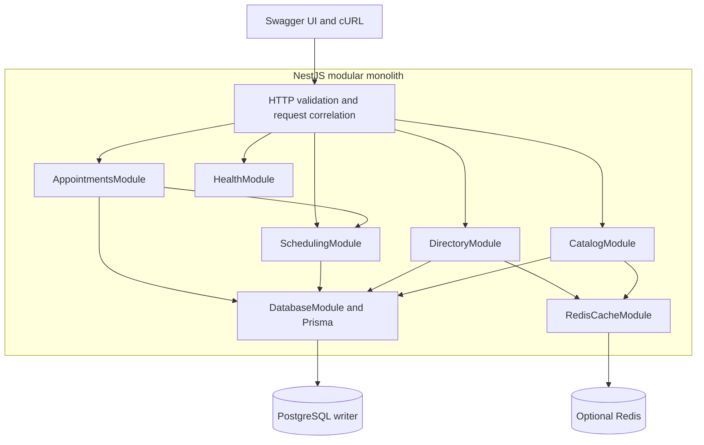
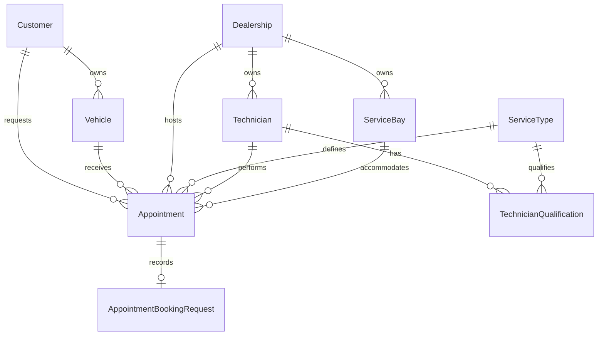
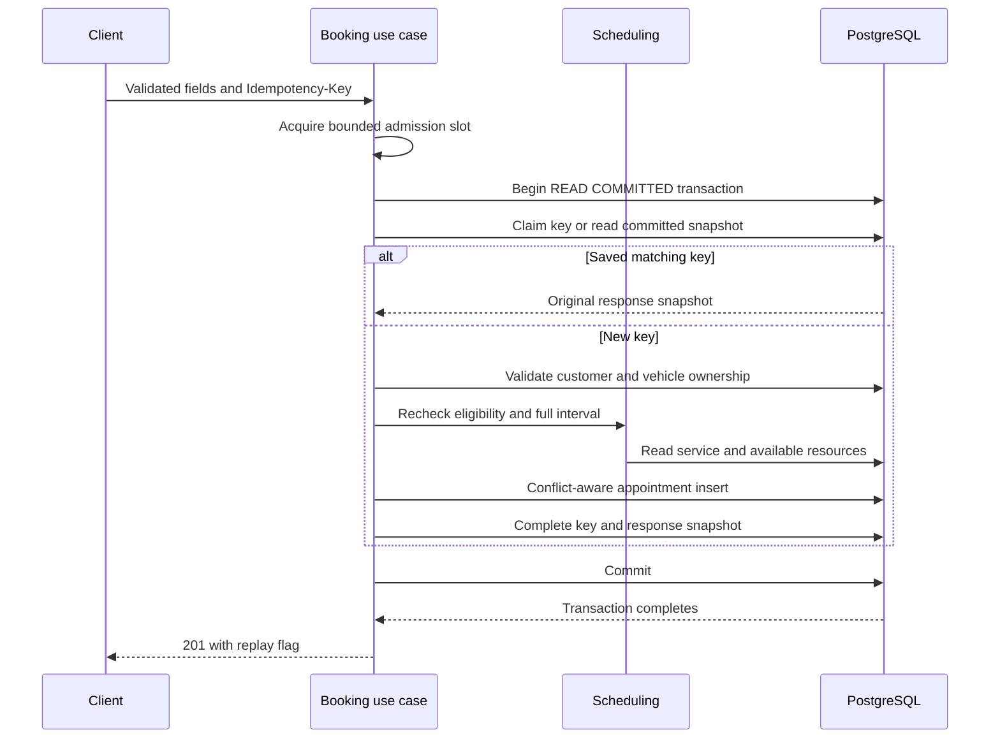

# Keyloop Service Scheduler

> Preserved presentation draft; author review/placeholders remain. Use the [current specification](../SPEC.md), [system design](../SYSTEM_DESIGN.md), and [verification summary](../FINAL_REVIEW.md) for current behavior.

**System Design Document**

Scenario A | Backend implementation | Design and verification baseline

| Document control      | Value                                                  |
| --------------------- | ------------------------------------------------------ |
| Author                | [Your name]                                            |
| Version and date      | 1.0 / 5 November 2026                                  |
| Repository            | [Repository URL]                                       |
| Final source revision | [Commit SHA after final verification]                  |
| Audience              | Keyloop technical reviewers and implementing engineers |
| Document status       | Author review required before submission               |

## 1 Executive summary

The Unified Service Scheduler replaces manual appointment booking with an API that allocates a qualified technician and an available service bay for the entire service interval. A successful request persists a confirmed appointment linking the customer, vehicle, dealership, service, technician, and bay.

The design uses a NestJS modular monolith and one PostgreSQL writer. PostgreSQL exclusion constraints enforce resource exclusivity across application instances. A transaction commits the appointment and its idempotency response together; bounded admission and fresh-transaction retries control contention. Redis is optional and caches only service types and dealership pages.

The principal design decision is to make the database the final authority for resource overlap. Availability reads help clients select a time but create no reservation. Booking revalidates resources and returns success only after commit.

Local holiday experiments confirmed 500 valid requests on four prestarted application processes in two trials. These results describe synthetic bursts on one shared laptop. Production sizing, automatic scaling, monetary savings, and sustained throughput remain unverified. Section 11 records the evidence and failed configurations.

### Design priorities

- Preserve full-duration resource exclusivity and atomic persistence.
- Keep business rules explicit and the architecture understandable.
- Support claims with actual PostgreSQL, HTTP, and concurrency evidence.

<!-- PAGE -->

## Document navigation

| Section  | Subject                                       | Word page |
| -------- | --------------------------------------------- | --------: |
| 1        | Executive summary and document control        |         1 |
| 2        | Requirements and scope                        |         3 |
| 3        | Architecture and technology choices           |         4 |
| 4        | Data model and persistence                    |         5 |
| 5        | Scheduling rules and database safeguards      |         6 |
| 6        | Booking data flow and concurrency             |         7 |
| 7        | API contract and errors                       |         8 |
| 8        | Reliability and caching                       |         9 |
| 9        | Security and observability                    |        10 |
| 10       | Operation and recovery                        |        10 |
| 11       | Verification and holiday measurements         |        11 |
| 12       | Design decisions and GenAI collaboration      |        12 |
| Appendix | Limitations, references, and author checklist |        13 |

### Assessment coverage

The original assessment permits a free choice of document format. Its six system-design expectations are covered as follows. The source is _Keyloop Technical Assessment_, V1.0, printed page 3; Scenario A appears on pages 1 and 2, with submission and evaluation criteria on page 4.

| Assessment expectation                              | Location   |
| --------------------------------------------------- | ---------- |
| Architecture diagram and component responsibilities | Section 3  |
| Explanation of data flow                            | Section 6  |
| Chosen technologies and justifications              | Section 3  |
| Observability strategy                              | Section 9  |
| Dedicated design-phase GenAI account                | Section 12 |

The README remains the operational entry point and contains the required AI Collaboration Narrative. Swagger supplies the API client demonstration; the video is a separate deliverable.

<!-- PAGE -->

## 2 Requirements and scope

### Mandatory Scenario A behavior

| ID   | Requirement                                                                         | Design response and evidence                                                                                                        |
| ---- | ----------------------------------------------------------------------------------- | ----------------------------------------------------------------------------------------------------------------------------------- |
| K R1 | Request a vehicle service at a dealership and desired time                          | POST accepts customer, vehicle, dealership, service type, and start time; DTO and HTTP tests exercise input rules.                  |
| K R2 | Verify a bay and qualified technician for the complete duration before confirmation | Scheduling reads eligibility and interval overlap inside booking; PostgreSQL tests exercise both resources and concurrent requests. |
| K R3 | Persist the confirmed customer, vehicle, technician, and bay association            | One PostgreSQL transaction commits the appointment; retrieval, rollback, and persistence tests inspect stored state.                |

### Engineering safeguards and selected additions

Atomic persistence, database non-overlap, ownership validation, safe failures, and meaningful tests support correctness. They are engineering safeguards rather than separate features requested by the assessment. Durable idempotency, optional reference-list caching, paginated lookup/history APIs, and the holiday benchmark are selected project additions. The 100-request burst criterion is a project verification target, not a Keyloop traffic forecast.

### Documented business assumptions

- Service types are global. Duration is a positive number of whole minutes. All active bays can support every service.
- Technicians and bays each belong to one dealership; technicians must also be active and service-qualified.
- Only CONFIRMED appointments occupy resources. CANCELLED records are supported in storage but there is no cancellation API.
- New bookings require a future timestamp with an explicit UTC offset. End time and resource assignments are server-controlled.
- Seeded reference data has no concurrent administrative write workflow. Existing appointments retain their stored duration after catalog changes.

### Scope exclusions

Authentication, dealership authorization, opening hours, shifts, cancellation/rescheduling, notifications, a frontend, specialized bays, and vehicle-overlap prevention are outside the implemented MVP. There is no public technician-list endpoint. These boundaries keep the submission focused; they are not claims that production would need no further work.

<!-- PAGE -->

## 3 Architecture and technology choices



_Figure 1. Logical components. Booking and availability always use PostgreSQL._

| Component             | Responsibility                                                                        |
| --------------------- | ------------------------------------------------------------------------------------- |
| HTTP and controllers  | Validate transport input, correlate requests, serialize results, and map safe errors. |
| AppointmentsModule    | Orchestrate admission, idempotency, confirmation, retrieval, and customer history.    |
| SchedulingModule      | Validate service/time, read eligible resources, and select a deterministic pair.      |
| DatabaseModule        | Own Prisma lifecycle and the ten-connection pool per application process.             |
| Catalog and Directory | Read booking inputs; only service types and dealership pages use cache-aside.         |
| HealthModule          | Report process liveness without querying PostgreSQL per health request.               |

TypeScript provides checked contracts; NestJS provides modules and dependency injection; PostgreSQL supplies transactions, foreign keys, and GiST exclusions. Prisma supplies typed access and migrations, with reviewed SQL for unsupported constraints. Vitest and Supertest test behavior; Docker Compose supplies reproducible local dependencies; Swagger and cURL demonstrate the backend. Optional Redis provides shared list caching with PostgreSQL fallback.

Concrete repositories avoid a generic persistence framework. Passing the Prisma transaction client into shared scheduling reads is a deliberate coupling that keeps confirmation on one allocation algorithm. Pure interval functions remain independently testable. One deployment unit fits the assessment's scope.

<!-- PAGE -->

## 4 Data model and persistence



_Figure 2. Persistent relationships. Each committed application booking completes one key record._

| Entity group              | Important fields and constraints                                                            |
| ------------------------- | ------------------------------------------------------------------------------------------- |
| Customer and Vehicle      | UUID identities; vehicle customer foreign key; unique VIN.                                  |
| Dealership                | UUID, name, and display time zone; parent of technicians and bays.                          |
| ServiceType               | Positive durationMinutes and active flag.                                                   |
| Technician and ServiceBay | UUID, dealership foreign key, and active flag.                                              |
| TechnicianQualification   | Composite primary key on technician and service type.                                       |
| Appointment               | Six reference IDs, start/end instants, status, and audit timestamps.                        |
| AppointmentBookingRequest | UUID key, SHA-256 request fingerprint, unique appointment link, and JSONB success snapshot. |

Appointment instants use TIMESTAMPTZ(3). API timestamps serialize as UTC ISO strings; comparisons use absolute instants. The dealership time zone does not implement opening hours. Required appointment references use restrictive foreign keys; schema and SQL migrations together define the database contract.

Nullable idempotency response/link fields support the uncommitted key claim. SQL requires them to be paired, but another write path could still commit a completely empty claim. The application transaction is responsible for completion before commit. Successful keys are retained indefinitely; no cleanup process is implemented.

<!-- PAGE -->

## 5 Scheduling rules and database safeguards

### Interval and eligibility rules

The service catalog defines the interval: endAt is startAt plus durationMinutes. Resources must be available for the entire half-open interval [startAt, endAt). Two intervals overlap when both conditions below hold; an appointment ending at 10:30 permits another to start at 10:30.

```text
existing.startAt < requested.endAt
AND existing.endAt > requested.startAt
```

Scheduling reads active, qualified technicians and active bays in the requested dealership, excluding confirmed overlaps. Candidate IDs are sorted for deterministic selection. If either set is empty, the request has no available pair. Cancelled appointments do not occupy resources. The query uses set-based NOT EXISTS reads rather than a query per candidate.

### Database enforcement

```sql
EXCLUDE USING gist (
  technician_id WITH =,
  tstzrange(start_at, end_at, '[)') WITH &&
) WHERE (status = 'CONFIRMED');
```

The migration installs btree_gist and creates an independent equivalent constraint for service_bay_id. Separate constraints prevent reuse of either resource, even with different pairings. A conflicting plain INSERT fails with PostgreSQL SQLSTATE 23P01, including outside the application. Positive duration and start_at < end_at also have SQL checks.

| Invariant                                                                              | Enforcement boundary                                                                             |
| -------------------------------------------------------------------------------------- | ------------------------------------------------------------------------------------------------ |
| Required references and valid record identity                                          | PostgreSQL NOT NULL, foreign keys, primary/unique keys.                                          |
| Positive duration and valid interval ordering                                          | PostgreSQL CHECK constraints and application validation.                                         |
| No confirmed technician or bay overlap                                                 | Independent partial GiST exclusion constraints.                                                  |
| Ownership, qualification, active flags, dealership scope, and catalog-derived duration | Application checks during confirmation; not all represented by cross-table database constraints. |

The latter boundary assumes controlled reference-data writes. Database non-overlap does not independently prove every business rule. Existing GiST indexes match resource/range availability predicates; B-tree indexes support reference lookups and history. Additional indexes need measured query benefits because every index adds storage and write cost.

<!-- PAGE -->

## 6 Booking data flow and concurrency



_Figure 3. Success paths. Failed transactions roll back before any fresh attempt._

READ COMMITTED availability can become stale between statements. The insert therefore uses createManyAndReturn with skipDuplicates so PostgreSQL arbitrates conflicts against both exclusions. An empty insert becomes a resource conflict after an identity-collision check; it is not a successful booking.

A resource conflict rolls back the key claim and insert, then retries allocation in a fresh transaction with jitter and the original shared deadline. Four allocation attempts are allowed by default. Fresh reads can select another eligible pair. Settled shortage returns 409; unresolved contention returns 503. Unexpected errors propagate as safe 500 responses rather than being relabeled as shortage.

The transaction promise must complete before HTTP success. A completed success is not replaced with a late timeout. Backoff holds no transaction connection. Same-key waiting has a separate deadline-bounded retry policy and does not consume allocation attempts. Exclusions enforce multi-instance resource safety; the per-process queue only controls admission.

<!-- PAGE -->

## 7 API contract and errors

| Operation             | Endpoint relative to /api/v1                                                              |
| --------------------- | ----------------------------------------------------------------------------------------- |
| Confirm and retrieve  | POST /appointments; GET /appointments/:id                                                 |
| Advisory availability | GET /dealerships/:dealershipId/availability                                               |
| Booking inputs        | GET /service-types; GET /dealerships; GET /customers; GET /customers/:customerId/vehicles |
| Customer history      | GET /customers/:customerId/appointments                                                   |

GET /health supplies liveness. /docs and /docs-json expose Swagger UI and OpenAPI. Paginated lookups/history default to page 1 and limit 20, with limit at most 100. Service types return an active catalog array. No endpoint accepts a client-selected technician or bay.

### Confirmation request

POST requires Content-Type application/json and exactly one UUID v4 Idempotency-Key header. This example uses seeded references and an illustrative future time; availability remains subject to current stored state.

```json
{
  "customerId": "20000000-0000-4000-8000-000000000001",
  "vehicleId": "30000000-0000-4000-8000-000000000001",
  "dealershipId": "10000000-0000-4000-8000-000000000001",
  "serviceTypeId": "40000000-0000-4000-8000-000000000001",
  "startAt": "2035-01-15T10:00:00.000Z"
}
```

A 201 response includes appointment ID, all six reference IDs, startAt, server-derived endAt, CONFIRMED status, and createdAt. Idempotency-Replayed reports false for creation and true for replay; both return 201. Responses carry x-request-id. Unknown DTO properties and malformed UUIDs/timestamps are rejected.

| Status    | Meaning and representative code                                                                             |
| --------- | ----------------------------------------------------------------------------------------------------------- |
| 400 / 404 | Malformed input VALIDATION_ERROR / missing referenced entity.                                               |
| 409 / 422 | NO_AVAILABILITY or IDEMPOTENCY_KEY_REUSED / BUSINESS_RULE_VIOLATION.                                        |
| 503       | BOOKING_BUSY, BOOKING_TIMEOUT, BOOKING_CONTENTION, or recognized SERVICE_UNAVAILABLE; includes Retry-After. |
| 500       | Unexpected INTERNAL_ERROR; safe public message.                                                             |

Errors use { error: { code, message, details? }, requestId }. Validation details are safe DTO messages; SQL, credentials, and stack traces are excluded.

<!-- PAGE -->

## 8 Reliability and caching

### Durable idempotency

The client creates one UUID v4 key per booking intent and retains it across uncertain outcomes. PostgreSQL stores a normalized five-field request fingerprint, appointment link, and serialized success in the same transaction. Matching successful keys replay across processes and restarts, even after the booked time passes or catalog data changes. A different payload with an already successful key returns 409. Failed transactions do not consume the key; a new key represents a new intent and may create another appointment.

| Failure or competition                                  | Handling                                                                                                                     |
| ------------------------------------------------------- | ---------------------------------------------------------------------------------------------------------------------------- |
| Another request is still claiming the same key          | Lock timeout becomes key contention; roll back, wait briefly, and retry in a fresh transaction within the original deadline. |
| Exclusion conflict or recognized transaction contention | Re-evaluate allocation using bounded fresh transactions and jitter.                                                          |
| Admission full or deadline exhausted                    | Explicit 503; no unbounded queue or retry loop.                                                                              |
| Response lost after commit                              | Client retries the same key to recover the stored success.                                                                   |
| Unexpected database error                               | Preserve rollback and return safe 500; do not invent availability exhaustion.                                                |

Prisma error codes and adapter metadata must be inspected together. The implementation does not assume SQLSTATE is always directly exposed: exclusion errors can appear through adapter metadata, and generic Prisma codes alone are insufficient classification. Regression tests preserve safe handling of unexpected errors.

### Optional shared cache

Only active service types and dealership pages use Redis cache-aside. Cache keys are namespaced/versioned; dealership keys include normalized page and limit. Payloads are validated, empty results are valid hits, and entries expire after five minutes. Redis failure or malformed data falls back to PostgreSQL. A PostgreSQL failure remains visible rather than becoming an empty successful list.

Controlled changes invalidate affected keys/pages after commit. Concurrent stale refill remains possible, so TTL is not a strict freshness guarantee from update time. Booking, availability, customers, vehicles, history, and idempotency bypass Redis. There is one optional Redis connection per app instance, and no update API or background refresh worker.

<!-- PAGE -->

## 9 Security and observability

### Current security boundary

This is an unauthenticated assessment demo using synthetic data. Customer listing and history have no identity-based access control and must not be presented as suitable for public deployment with real customer data. Production use would first require authentication, dealership/customer authorization, transport security, secret management, and restricted runtime/migration roles.

The implemented controls are strict DTO whitelisting, UUID/time validation, backend-owned assignments, parameterized database values, validated environment configuration, safe startup errors, and omission of private data from application error logs. Swagger is deliberately open for review. No complete security assessment or production hardening claim is made.

### Implemented and proposed telemetry

| Status      | Signal and purpose                                                                                                                                    |
| ----------- | ----------------------------------------------------------------------------------------------------------------------------------------------------- |
| Implemented | Correlated JSON logs for request completion, booking start/confirmation/replay, conflicts/retries, admission rejection, and classified HTTP failures. |
| Implemented | Request IDs in response headers/error bodies; safe outcome codes, duration/queue time, retry count, and available SQLSTATE.                           |
| Proposed    | Outcome counters, latency histograms, queue/pool saturation, retry exhaustion, and database resource monitoring.                                      |
| Proposed    | Request-to-transaction tracing when deployment needs justify a collector.                                                                             |

Names, VINs, complete payloads, credentials, SQL, and raw database errors are omitted by the request/error handlers. There is no metrics backend, trace exporter, dashboard, or external log collector in the MVP.

## 10 Operation and recovery

Docker Compose supplies development and separate test dependencies. The README documents environment setup, migrations, deterministic seeds, build/run commands, and Swagger access. Reviewed migrations include btree_gist and exclusions; Prisma schema alone is insufficient to recreate those safeguards.

Startup validates PostgreSQL connectivity with SELECT 1. Shutdown hooks close application resources; Prisma and Redis disconnect. GET /health is liveness, not database readiness. Booking defaults are eight active plus 128 pending requests and ten pooled connections per process, four allocation attempts, and a shared five-second budget. PostgreSQL defaults are 250 ms lock, two-second statement, and five-second transaction limits. These layers are separate; the booking budget is not a strict end-to-end HTTP deadline.

Tests create uniquely named disposable databases and never reset development data. Backup restoration, production readiness probes, deployment rollback, and multi-host failure recovery remain deployment work requiring separate verification.

<!-- PAGE -->

## 11 Verification and holiday measurements

Tests demonstrate use cases rather than line coverage: pure interval rules; invalid/missing/ownership inputs; inactive, unqualified, and wrong-dealership resources; every overlap shape and adjacency; cancelled records; alternatives; rollback; direct database violations; stale availability; persistence; idempotent replay; safe failures; and cache fallback/invalidation.

| Evidence recorded on 5 November 2026     | Result and boundary                                                                                                       |
| ---------------------------------------- | ------------------------------------------------------------------------------------------------------------------------- |
| Full default and PostgreSQL/Redis suites | 171 default and 216 integration tests passed in the prior reliability follow-up.                                          |
| Focused concurrency / worker lifecycle   | Six PostgreSQL concurrency cases and one child-process case passed for the holiday follow-up.                             |
| Core contested pair                      | Twenty-request regression retained; popular-time load trial confirmed one of 250 and returned 249 availability conflicts. |

### Local holiday experiment

The synthetic appointment day has twenty dealerships, two eligible technician/bay pairs each, and sixteen half-hour slots: capacity 640. Offered intents have enough appointment capacity. k6 releases clients from a barrier, and SQL reconciles confirmed responses, complete key records, resource overlaps, valid associations, and the day window.

| Burst requests | App processes | Confirmed | Busy 503 | Strict result |
| -------------: | ------------: | --------: | -------: | ------------- |
|            100 |             1 |       100 |        0 | PASS          |
|            250 |             1 |       137 |      113 | FAIL          |
|            250 |             2 |       250 |        0 | PASS twice    |
|            500 |             2 |       272 |      228 | FAIL          |
|            500 |             4 |       500 |        0 | PASS twice    |

All final database invariants and holiday post-burst health/availability reads passed. The failed 250/one-process trial also had 98 health warmup connection resets with unresolved cause. Failed profiles remain failures. Four-process 500-request p95 was 1.20 to 1.85 seconds across two trials; lower percentiles in rejecting profiles include fast failures.

Environment: Apple M2, eight logical CPUs, 16 GiB RAM, PostgreSQL 17.6 in Docker, Node 24.21.0, and k6 2.3.0, all on one laptop. Workers use the real application through the test factory and ts-node. More prestarted workers helped these bursts; this does not measure an autoscaling transition, cloud cost, sustained capacity, or a production latency objective. Keep the modular monolith and one writer; aggregate connection pools must fit the database budget.

Source fingerprints, commands, failures, and raw-report paths are in [HOLIDAY_PEAK.md](../HOLIDAY_PEAK.md). [FINAL_REVIEW.md](VERIFICATION_HISTORY.md) records correctness checks. This document uses those recorded results; verify the final submission revision separately.

<!-- PAGE -->

## 12 Design decisions and GenAI collaboration

### Decisions and tradeoffs

| Decision                                   | Reason and consequence                                                                                                                                         |
| ------------------------------------------ | -------------------------------------------------------------------------------------------------------------------------------------------------------------- |
| Modular monolith and concrete repositories | Keeps one understandable deployment and short call paths; accepts narrow Prisma transaction-client coupling.                                                   |
| READ COMMITTED plus two exclusions         | Preserves resource safety across instances without distributed locks; availability races require conflict-aware insertion and fresh retries.                   |
| Bounded admission and deadlines            | Limits queued work and connection pressure; excess valid demand can receive 503.                                                                               |
| Durable successful-key replay              | Resolves duplicate intent and uncertain responses; requires client key discipline and indefinite record storage.                                               |
| Narrow optional Redis cache                | Avoids selected reference reads across instances; adds an operational dependency and eventual-consistency maintenance. No measured throughput gain is claimed. |
| Seeded reference data                      | Keeps the assessment manageable; concurrent admin changes need a separately designed consistency workflow.                                                     |

### GenAI use during design

The developer selected Scenario A, backend scope, TypeScript/NestJS/PostgreSQL/Prisma, Vitest, phased delivery, and constraints on complexity. AI assisted requirements interpretation, data-model and constraint alternatives, transaction/error design, tests, and documentation. The developer directed scope and challenged generated decisions; runnable evidence supports the resulting choices.

The design evolved from temporary resource-row locking to the approved conflict-aware insert with existing exclusions and fixed PostgreSQL defaults. Independent database experiments exposed Prisma error metadata behavior and an overly narrow test assumption about contention failures. The design records both the final approach and retained failed trials instead of treating AI output as authority.

Later verification found a duplicate listener start in the load worker. A real child-process regression failed before correction and passed afterward. Failure-log tests similarly demonstrated missing classified events before their correction. These are documented examples of testing generated output; they are separate from the initial design phase.

### Evidence and developer ownership

The [README AI narrative](../../README.md#ai-collaboration-narrative), phase notes, [CONCURRENCY_PROPOSAL.md](CONCURRENCY_PROPOSAL.md), [IDEMPOTENCY.md](IDEMPOTENCY_HISTORY.md), and [FINAL_REVIEW.md](VERIFICATION_HISTORY.md) record the decisions and observed checks. The developer should explain the constraints, replay contract, error classification, and evidence limits personally. Commit history is supporting context and does not establish who authored every line. No fabricated human correction, benchmark, or recorded video is claimed.

<!-- PAGE -->

## Appendix

### Risks and future decisions

| Current limitation                              | Consequence and next decision                                                                                                                         |
| ----------------------------------------------- | ----------------------------------------------------------------------------------------------------------------------------------------------------- |
| No authentication or authorization              | Restrict this demo to synthetic/local use; define identity and ownership access before real deployment.                                               |
| Application-only cross-table business checks    | Another writer could bypass ownership/qualification rules; introduce controlled writes and transaction rules before admin APIs.                       |
| Different keys and vehicle overlap              | A vehicle can have overlapping bookings on different resources; agree the business policy before adding a safeguard.                                  |
| No hours, shifts, cancellation, or rescheduling | All-day resource availability is an MVP assumption; each feature needs explicit rules and tests.                                                      |
| Shared-host load evidence                       | Hosted capacity, autoscaling delay, costs, and network faults need separate measurements. Health warmup resets in the failed trial remain unresolved. |
| Indefinite successful-key retention             | Storage grows with bookings; define any future retention policy without breaking replay promises.                                                     |

### Source and evidence register

1. Keyloop Technical Assessment, V1.0, 1 January 2025: Scenario A on printed pages 1 and 2; design requirements on page 3; submission and evaluation on page 4. Source supplied as Keyloop Coding Challange.pdf.
2. [SPEC.md](SPEC_PLANNING.md) and AGENTS.md: implementation assumptions and approved scope. The original assessment defines mandatory requirements.
3. [SYSTEM_DESIGN.md](../SYSTEM_DESIGN.md), [DATABASE.md](../DATABASE.md), prisma/schema.prisma, and prisma/migrations: detailed implementation and database safeguards.
4. [IDEMPOTENCY.md](IDEMPOTENCY_HISTORY.md), [FINAL_REVIEW.md](VERIFICATION_HISTORY.md), and test/: verification details and limitations. The full suite counts in Section 11 predate the holiday tooling changes.
5. [HOLIDAY_PEAK.md](../HOLIDAY_PEAK.md) and [LOAD_RESULTS.md](../LOAD_RESULTS.md): dated working-source measurements, raw-report locations, successes, failures, and environment boundaries.
6. [README.md](../../README.md): setup, booking examples, and AI narrative. The former `DEMO_GUIDE.md` presentation aid has been removed from the submission.

### Author completion checklist

- Complete author, repository URL, and final revision in document control; refresh the version/date and page navigation after edits.
- Explain the design in your own words and reconcile final code changes with diagrams, contracts, and evidence.
- Record commit-specific verification results; retain historical source boundaries.
- Record the required 5 to 10 minute video, set [Video URL], and verify repository/video access. Submit one consistent reviewed design document.
